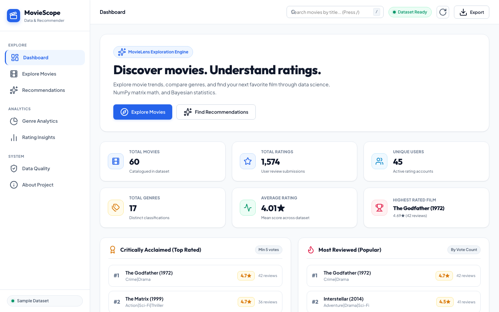
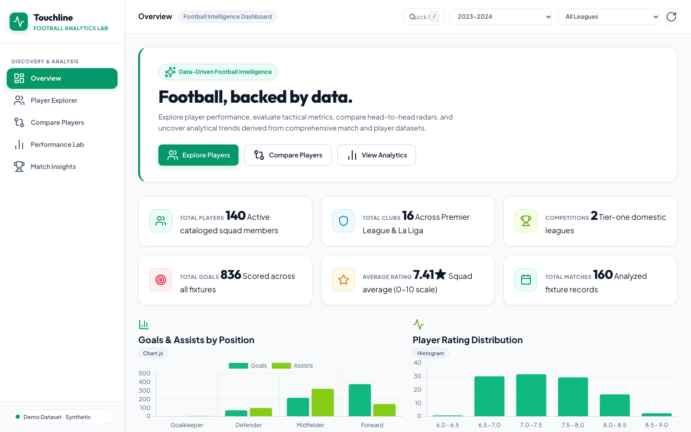
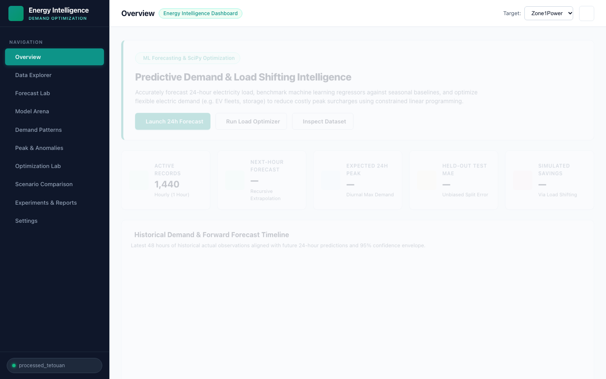
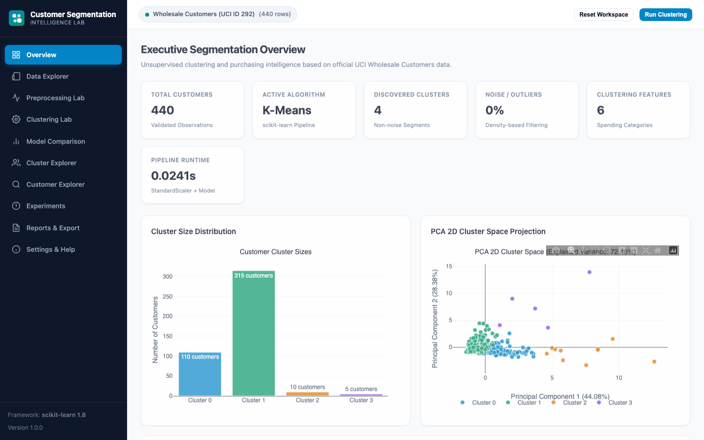
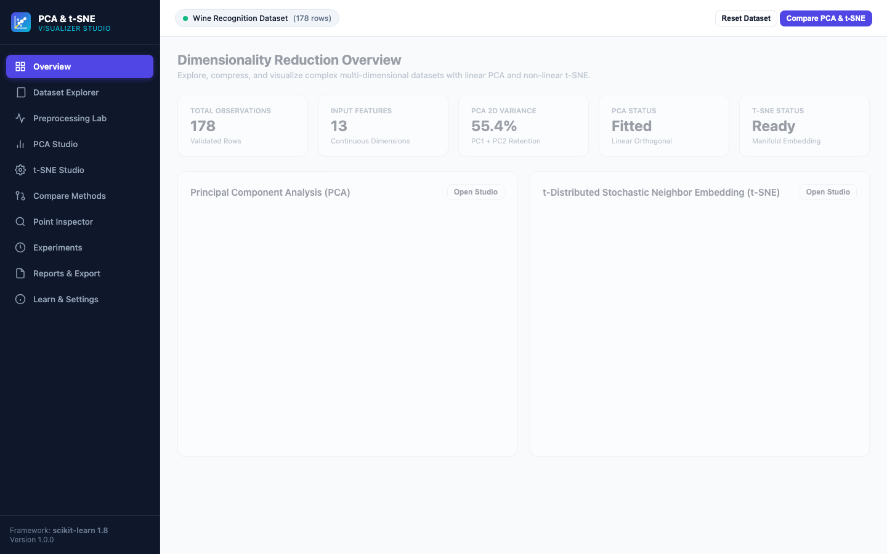

# Hack-o-Week: 5th Semester Machine Learning Projects

A comprehensive collection of full-stack machine learning, statistical modeling, clustering, natural language processing, dimensionality reduction, and ensemble learning web applications developed for the 5th Semester Hack-o-Week curriculum.

Every week features an interactive, runnable web application built with professional engineering standards—scikit-learn Pipelines, real fitted models, data leakage prevention, interactive Plotly visualizations, comprehensive test suites, and clean UI dashboards.

---

## Project Index & Weekly Breakdown

| Week | Project Name | Tech Stack | Port | Screenshots Preview |
|---|---|---|---|---|
| **W1-2** | **Exploratory Data Analysis & House Price Modeling Lab** | Vanilla JS, HTML5, CSS3, Node.js | `3000` | [View Previews](W1-2/screenshots/README.md) |
| **W3-4** | **Regression & Classification Studio** | Python 3, Flask, scikit-learn, Plotly.js | `5001` | [View Previews](W3-4/screenshots/README.md) |
| **W5-6** | **Decision Trees & Random Forest Visualizer** | Python 3, Flask, scikit-learn, Plotly.js | `5002` | [View Previews](W5-6/screenshots/README.md) |
| **W7-8** | **Naive Bayes Sentiment Classifier & NLP Studio** | Python 3, Flask, scikit-learn, NLTK, Plotly.js | `5003` | [View Previews](W7-8/screenshots/README.md) |
| **W9-10** | **Customer Segmentation & Intelligence Dashboard** | Python 3, Flask, scikit-learn, K-Means, DBSCAN, Plotly.js | `5004` | [View Previews](W9-10/screenshots/README.md) |
| **W11-12** | **Dimensionality Reduction Visualizer (PCA & t-SNE Studio)** | Python 3, Flask, scikit-learn, Plotly 2D/3D | `5005` | [View Previews](W11-12/screenshots/README.md) |
| **W13-14** | **Ensemble Learning & Generalization Lab** | Python 3, Flask, scikit-learn, XGBoost, LightGBM | `5006` | [View Previews](W13-14/screenshots/README.md) |

---

## Visual Previews

### W1-2: EDA & House Price Modeling


### W3-4: Regression & Classification Studio


### W5-6: Decision Trees & Random Forest Visualizer


### W7-8: Naive Bayes Sentiment Classifier


### W9-10: Customer Segmentation Dashboard


### W11-12: Dimensionality Reduction Studio (PCA & t-SNE)


### W13-14: Ensemble Learning & Generalization Lab


---

## Key Methodological & Engineering Principles

1. **Zero Data Leakage:** Imputers, encoders, and scalers are fitted strictly on training subsets within scikit-learn Pipelines.
2. **Realistic Feature Safeguards:**
   - In UCI Bank Marketing (`W13-14`), call `duration` is excluded by default to prevent pre-call target leakage.
   - In UCI Bike Sharing (`W13-14`), circular ridership counts `casual` and `registered` are excluded when predicting total rentals `cnt`.
3. **Empirical Estimator Execution:** Every metric, curve, and embedding is calculated from real fitted models—no mocked or static placeholders.
4. **Automated Testing:** Each project contains a standalone test suite (`pytest`) verifying data loaders, preprocessing pipelines, model catalogs, and API endpoints.

---

## Quickstart

To run any individual module:

```bash
# Example: Running W13-14 Ensemble Lab
cd W13-14
python3 -m venv .venv
source .venv/bin/activate
pip install -r requirements.txt
python3 app.py
# Open http://127.0.0.1:5006
```

To run tests:
```bash
python3 -m pytest -q
```
