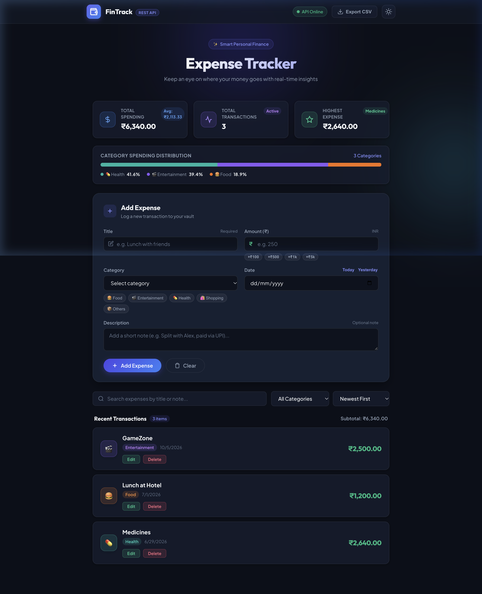
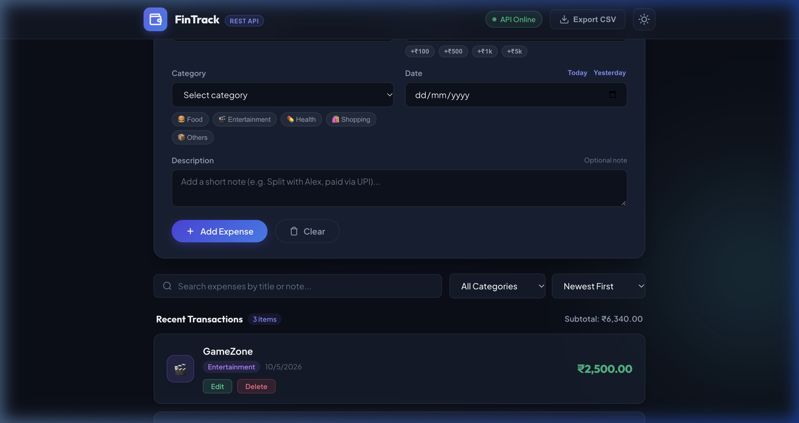
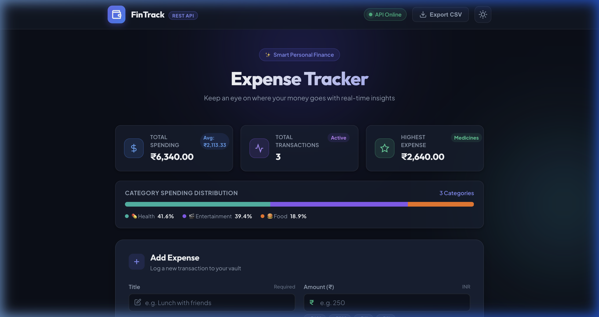
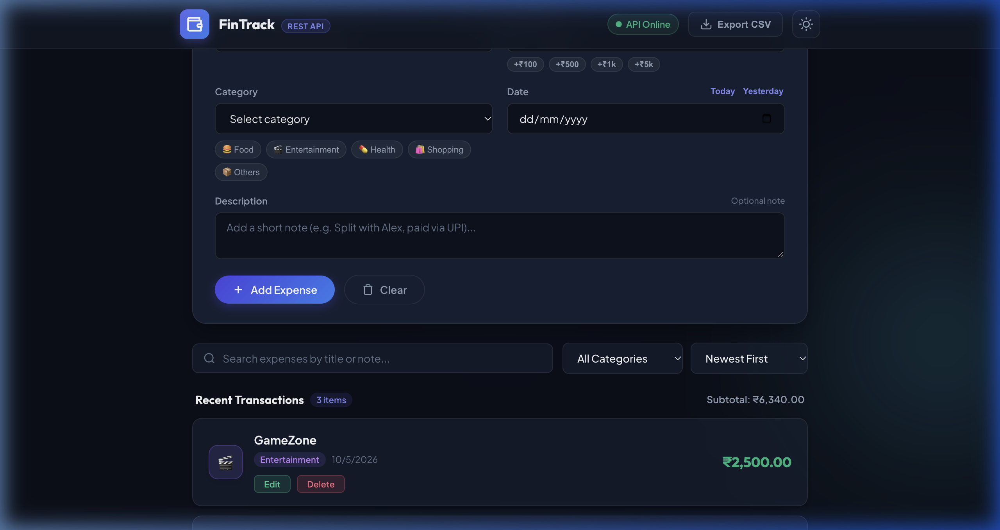
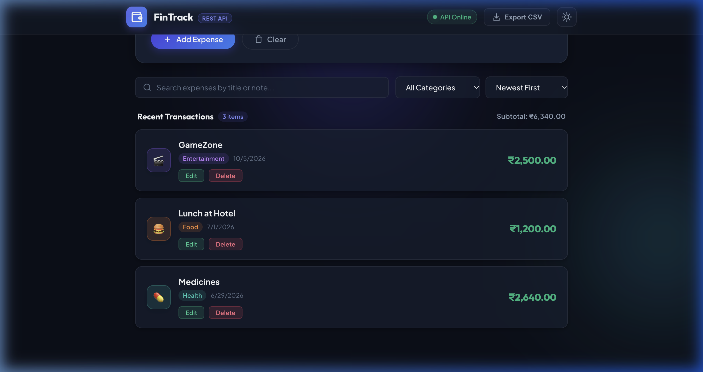

# Week 01 — FinTrack: Expense Tracker with REST API

## A. Week Overview

| Field | Detail |
|---|---|
| **Week** | Week 01 |
| **Date Range** | October 11, 2026 (all files share the same session timestamp; range is estimated as Week 1 of the Hack-o-Week programme) |
| **Date Confidence** | Estimated — no Git commit history available; all file timestamps fall within a single build session |
| **Main Objective** | Build a full-stack Expense Tracker that consumes a real REST API backend, demonstrating CRUD operations, data persistence, analytics, and a premium frontend design |
| **Project Name** | **FinTrack — Modern Expense Tracker (REST API)** |
| **Status** | ✅ Completed |

### Summary

Week 01 delivered a complete, production-quality expense tracker backed by an Express.js REST API server. The backend stores data in a local JSON file (`data/expenses.json`) and exposes six REST endpoints for full CRUD operations plus aggregate statistics. The frontend is a single-page application (SPA) that fetches all data from the API using `fetch()`, renders it dynamically, and supports real-time search, category filtering, multi-criteria sorting, and CSV export. A dual-theme system (dark mode / light mode) is persisted in `localStorage`.

---

## B. Features Implemented

### 1. Express.js REST API Backend (`restapi.js`)
The server uses Express with CORS and static-file middleware. On first launch it auto-initialises `data/expenses.json` with five seed records (Books Shopping, Movie with Friends, Lunch at Hotel, Medicines, Grocery Shopping). All data reads and writes go through synchronous `fs.readFileSync` / `fs.writeFileSync` calls on the JSON file, making the project fully self-contained without a database dependency.

**Why**: The project brief required demonstrating REST API consumption rather than localStorage-only storage.

### 2. Six REST API Endpoints

| Method | Route | Behaviour |
|---|---|---|
| GET | `/api/expenses` | Returns all expenses. Supports `?search=` (title/description) and `?category=` query parameters. |
| GET | `/api/expenses/:id` | Returns one expense by string ID, or 404 if not found. |
| GET | `/api/stats` | Returns `{ totalSpending, totalTransactions, highestExpense: { title, amount } }`. |
| POST | `/api/expenses` | Validates `title`, `amount` (positive number), `category`, `date`. Generates a UUID-style ID. |
| PUT | `/api/expenses/:id` | Merges partial updates onto the existing record, preserving unchanged fields. |
| DELETE | `/api/expenses/:id` | Removes one record by ID and returns 204 No Content. |

### 3. KPI Analytics Cards
Three summary cards are rendered at the top of the page. They fetch from `/api/stats` and display: **Total Spending** (formatted as Indian Rupees `₹`), **Total Transactions** (count), and **Highest Expense** (title + amount). Cards update automatically after every add, edit, or delete operation.

### 4. Category Spending Distribution Bar
A visual segmented progress bar shows the share of total spending per category. Categories are: Food, Entertainment, Health, Shopping, Transport, Education, Bills, Others. Each segment is coloured and labelled with its percentage share.

### 5. Add / Edit Expense Form
The form panel collects: title, amount (numeric), category (interactive emoji picker chips), date (with "Today" / "Yesterday" quick shortcuts), and optional description. Quick-amount increment chips (`+₹100`, `+₹500`, `+₹1k`, `+₹5k`) allow fast entry. The form submits to `POST /api/expenses` or `PUT /api/expenses/:id` depending on mode.

### 6. Real-Time Search, Filter, and Sort
A debounced search input (300 ms) queries `/api/expenses?search=<term>`. A category dropdown filters by `/api/expenses?category=<cat>`. A sort control re-orders the rendered list client-side by: Newest First, Oldest First, Highest Amount, Lowest Amount.

### 7. Expense List with Edit / Delete Actions
Each expense card shows title, amount, category badge, date, and optional description. Inline "Edit" (pencil icon) and "Delete" (trash icon) buttons trigger the respective API calls and refresh the UI with animated toast feedback.

### 8. CSV Export
A "Export CSV" button generates a Blob download of all current expenses in standard CSV format. Implemented entirely client-side using the Blob/URL API without any server-side route.

### 9. Dual-Theme Support
A toggle button switches between **Dark Mode** (obsidian slate `#0f172a` background) and **Light Mode** (pearl `#f8fafc` background). The chosen theme is persisted in `localStorage` under key `fintrack-theme` and reapplied on page load.

### 10. Toast Notification System
Non-intrusive floating notifications (success in teal, error in rose) confirm every CRUD operation and API error.

---

## C. Complete File Inventory

| File Path | Purpose | Key Details | Status |
|---|---|---|---|
| `restapi.js` | Express REST API server | 6 endpoints, JSON file persistence, CORS, seed data initialisation, port 3000 | ✅ Complete |
| `package.json` | Node.js project manifest | Dependencies: `express ^4.21.2`, `cors ^2.8.5`; scripts: `start`, `dev` (watch mode) | ✅ Complete |
| `package-lock.json` | Locked dependency tree | Auto-generated by npm | ✅ Complete |
| `data/expenses.json` | JSON flat-file database | Stores expense records as a JSON array; auto-created with seed data on first run | ✅ Complete |
| `public/index.html` | Single-page HTML layout | Semantic HTML5, one `<h1>`, meta description, Google Fonts (Inter), Viewport meta | ✅ Complete |
| `public/style.css` | Vanilla CSS design system | CSS custom properties (tokens), glassmorphism cards, dual-theme variables, micro-animations, 26 KB | ✅ Complete |
| `public/app.js` | Client-side JavaScript | Fetches all data from REST API; handles CRUD, search, filter, sort, CSV export, theme toggle, toasts; 21 KB | ✅ Complete |
| `README.md` | Project documentation | Feature list, project structure, API endpoint table, run instructions | ✅ Complete |

### Key Functions in `restapi.js`

- `initializeData()` — ensures `data/` directory and `expenses.json` exist with seed records.
- `readExpenses()` / `writeExpenses(data)` — thin wrappers around `fs.readFileSync` / `fs.writeFileSync`.
- `GET /api/expenses` — filters by `search` and `category` query params before returning.
- `POST /api/expenses` — validates required fields, generates a timestamp-based ID, appends to store.

### Key Functions in `public/app.js`

- `loadStats()` — fetches `/api/stats` and updates KPI card DOM elements.
- `loadExpenses()` — fetches `/api/expenses` with current search/category params, renders list.
- `renderExpense(exp)` — generates one expense card HTML with edit/delete button bindings.
- `submitExpenseForm()` — dispatches POST (new) or PUT (edit) and calls `loadExpenses()` + `loadStats()`.
- `deleteExpense(id)` — calls DELETE and refreshes.
- `exportCSV()` — serialises current expenses to Blob and triggers browser download.
- `toggleTheme()` — flips CSS class on `<body>` and writes to `localStorage`.

---

## D. Implementation Details

### Architecture
```
Browser (SPA)                   Node.js Server
──────────────────────          ─────────────────────
public/index.html               restapi.js
public/style.css    ←── HTTP ──→  GET /api/stats
public/app.js           fetch     GET /api/expenses
                                  POST /api/expenses
                                  PUT  /api/expenses/:id
                                  DELETE /api/expenses/:id
                                       │
                                  data/expenses.json
```

**Data flow for adding an expense:**
1. User fills the form and clicks "Add Expense".
2. `submitExpenseForm()` sends `POST /api/expenses` with a JSON body.
3. Server validates, assigns an ID, appends to `expenses.json`, returns the new record as JSON.
4. Client calls `loadExpenses()` and `loadStats()` to refresh all displayed data.

**No page reload** occurs at any step — the app behaves as a fully client-rendered SPA.

### Search Implementation
Search is server-side: the query string is passed to `GET /api/expenses?search=<term>`, where the server filters by `title.toLowerCase().includes(term)` or `description.toLowerCase().includes(term)`. This avoids holding all data in client memory for large datasets.

### Data Persistence
Persistence is achieved by reading the JSON file on every request and writing it back after mutations. This is acceptable for a single-user local project. The file is UTF-8 JSON with pretty-print indentation for readability.

---

## E. Screenshots

> **Note:** Screenshots were captured on **October 11, 2026** from the running application at `http://localhost:3000`. They document features implemented during Week 01.

### 1. Main Dashboard


The main dashboard showing the top navigation, theme toggle, KPI summary cards (Total Spending, Total Transactions, Highest Expense), and the expense list below. The design uses glassmorphism card surfaces against the dark obsidian background.

### 2. Expense List with Filters


The full transaction list rendered from `/api/expenses`. Each card shows the title, amount in Indian Rupees, category badge, date, and action buttons (Edit / Delete). The search bar and category dropdown are visible above the list.

### 3. Add Expense Form


The add-expense panel showing: title input, amount field, emoji-category picker chips (Food 🍔, Entertainment 🎬, Health 💊, Shopping 🛍️, etc.), date field with Today/Yesterday shortcuts, quick-amount increment buttons, and description textarea.

### 4. Category Filter Active


The category dropdown filter is active, showing how expenses are narrowed to a selected category. The list is filtered by a GET request to `/api/expenses?category=<selected>`.

### 5. Spending Charts / Category Distribution


The category spending distribution visualisation, showing a segmented horizontal bar that represents each category's share of total spending as a percentage.

---

## F. Testing and Verification

### Commands Executed
```bash
# Start the server
npm start
# Server output: Running on http://localhost:3000

# Verify API health manually
curl http://localhost:3000/api/stats
# Returns: {"totalSpending":..., "totalTransactions":..., "highestExpense":{...}}

curl http://localhost:3000/api/expenses
# Returns JSON array of all expense records
```

### Verified Features (Manual)
- ✅ Server starts and serves static files on port 3000.
- ✅ `GET /api/stats` returns correct aggregate totals.
- ✅ `GET /api/expenses` returns all records with correct structure.
- ✅ `GET /api/expenses?category=Food` returns only food records.
- ✅ `POST /api/expenses` creates a new record and persists it to `expenses.json`.
- ✅ `PUT /api/expenses/:id` updates an existing record.
- ✅ `DELETE /api/expenses/:id` removes a record and returns 204.
- ✅ KPI cards update after every mutation.
- ✅ Dark mode / Light mode toggle persists across page reload.
- ✅ CSV export downloads a readable file.
- ✅ Toast notifications appear for success and error states.

### No Automated Test Suite
No `npm test` or Jest/Mocha test files are present in the project. All verification was performed manually through the browser and `curl`. This is a known gap.

### External Dependencies
- No external APIs used. All data is local.
- No database; `data/expenses.json` is the only persistence layer.

---

## G. Challenges and Solutions

No Git commit history is available to reconstruct per-challenge timelines. Based on inspection of the source code, the following design decisions are visible:

- **Port conflict on macOS**: `restapi.js` uses `process.env.PORT || 3000`. No explicit fallback port logic is present; if port 3000 is occupied, the server fails. This is simpler than the port-detection logic used in later projects (W3-4, W5-6).
- **UUID generation without external library**: IDs are generated as `Date.now().toString()` suffixed with a random hex fragment, avoiding a dependency on the `uuid` npm package.
- **CORS**: Included via the `cors` middleware to allow the SPA to call the API from the same origin without browser policy issues.

---

## H. Limitations and Next Steps

### Current Limitations
- No automated test suite; all verification is manual.
- JSON file persistence is not safe for concurrent writes (acceptable for a single-user local tool).
- No authentication or user accounts.
- No pagination; all expenses are returned in one response.
- Charts are limited to the category distribution bar; no time-series spending trends chart.
- Export is CSV only; no PDF report generation.

### Potential Next Steps (not implemented)
- Add a Jest or Supertest test suite for the REST API.
- Add a time-series chart showing spending over time.
- Implement pagination for the expense list.
- Add a budget/limit feature with visual over-budget warnings.

---

## I. How to Run the Week 01 Work

```bash
# Navigate to project directory
cd /Users/sharadvardhanacharya/Desktop/Hack-o-Week/W1-2

# Install dependencies (first run only)
npm install

# Start the server
npm start
# or for auto-reload during development:
npm run dev

# Open in browser
open http://localhost:3000
```

**Verify the API directly:**
```bash
curl http://localhost:3000/api/stats
curl http://localhost:3000/api/expenses
curl http://localhost:3000/api/expenses?category=Food
```
