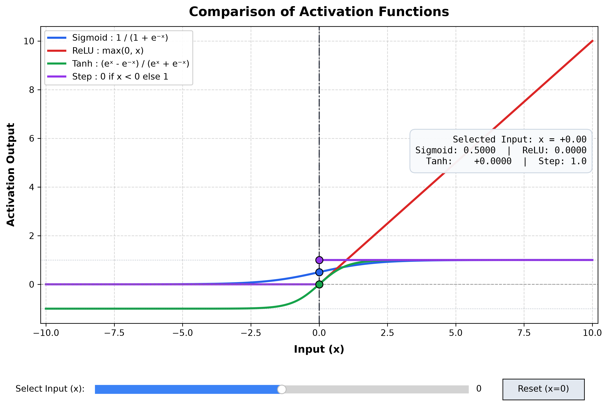
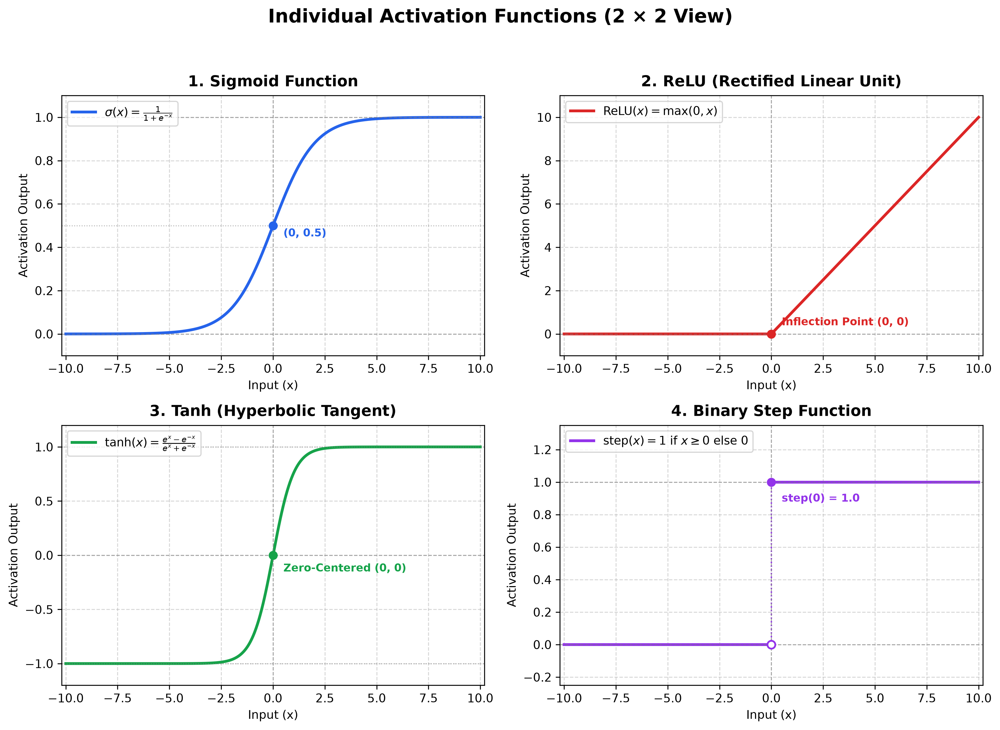

# Activation Function Visualizer

A clean, beginner-friendly Python educational application that visualizes and compares the four foundational activation functions in neural networks:

1. **Sigmoid**
2. **ReLU (Rectified Linear Unit)**
3. **Tanh (Hyperbolic Tangent)**
4. **Binary Step Function**

Built with **Python**, **NumPy**, and **Matplotlib**, this project demonstrates how each function transforms real-valued inputs into non-linear activations. It includes interactive sliders, 2×2 subplots, automated unit tests, and terminal-based inspection modes tailored for practical exams and lab demonstrations.

---

## Visual Previews

### 1. Combined Comparison Graph (Interactive Slider)


### 2. Individual Activation Functions (2 × 2 Subplots)


---

## Key Features

- **Mathematical Correctness & Vectorization:** All activation functions use NumPy arrays for fast, numerically stable computations.
  - Overflow protection for extreme negative inputs in Sigmoid via clipping.
  - Precise piecewise handling of the Step function ($x < 0 \to 0$, $x \ge 0 \to 1$).
- **Interactive Slider Widget:** Drag Matplotlib's slider between $-10.0$ and $+10.0$ to dynamically update point markers and output values in real-time.
- **2 × 2 Dedicated Subplots:** Individual plots for Sigmoid, ReLU, Tanh, and Step with customized y-axis scales, key points, and formulas.
- **Terminal Fallback & CLI Mode:** Fully functional terminal mode (`python main.py --cli` or `python main.py --input 2.5`) for headless environments or quick checks.
- **Zero Heavy Frameworks:** Uses only Python standard library, NumPy, and Matplotlib. No PyTorch, TensorFlow, Flask, or external bloat.
- **Comprehensive Unit Tests:** 14 automated unit tests built with Python's built-in `unittest` module.

---

## Project Structure

```
Activation_Function_Visualizer/ (or W14-15/)
│
├── main.py                      # Application entry point and CLI runner
├── activation_functions.py       # Core mathematical implementations (NumPy)
├── visualizer.py                 # Matplotlib interactive slider, subplots, and exports
├── test_activation_functions.py  # Unit tests using Python's unittest module
├── requirements.txt             # Minimal dependencies (numpy, matplotlib)
├── README.md                    # Project overview, installation, and guide
├── theory.md                    # Educational theory and top 12 viva questions
└── screenshots/                 # High-resolution saved plots
    ├── .gitkeep
    ├── comparison_graph.png
    ├── individual_subplots.png
    └── interactive_demo.png
```

---

## Step-by-Step Installation & Execution Guide

*(Instructions configured for **macOS Apple Silicon (M1/M2/M3/M4)** and **Visual Studio Code**)*.

### Step 1: Verify Python Installation
Open your macOS Terminal (or press `Cmd + Space`, type `Terminal`, and hit `Enter`).
Verify that Python 3 is installed:

```bash
python3 --version
```
*Expected output: `Python 3.10.x` or higher (e.g. `Python 3.14.0`).*

> **Note on macOS:** On Mac, `python` often points to an outdated system alias or doesn't exist. Always use `python3` if `python` returns an error.

---

### Step 2: Open the Project Folder in VS Code
1. Open Visual Studio Code.
2. Click **File** > **Open Folder...** (or press `Cmd + O`).
3. Navigate to:
   ```
   /Users/sharadvardhanacharya/Desktop/Hack-o-Week/W14-15
   ```
4. Open the integrated terminal inside VS Code by pressing:
   `Ctrl + ` `~` (backtick) or going to **Terminal** > **New Terminal**.
5. Check your current working directory by running:
   ```bash
   pwd
   ```
   You should see `.../Hack-o-Week/W14-15`.

---

### Step 3: Create a Virtual Environment
A virtual environment keeps your project dependencies isolated so they do not conflict with system packages.

```bash
# Create the virtual environment folder named .venv
python3 -m venv .venv

# Activate the virtual environment
source .venv/bin/activate
```
*Once activated, your terminal prompt will display `(.venv)` at the beginning of the line.*

---

### Step 4: Install Dependencies
Install the required packages (`numpy` and `matplotlib`):

```bash
python3 -m pip install -r requirements.txt
```

---

### Step 5: Run the Project

#### 1. Interactive Graphical Mode (Default)
```bash
python3 main.py
```
**What happens when the application starts:**
1. An ASCII welcome banner appears in your terminal.
2. Two high-resolution Matplotlib windows open:
   - **Window 1: Comparison of Activation Functions:** Shows all 4 curves plotted together. At the bottom, a blue **Slider** allows you to scrub input $x$ from $-10$ to $+10$. An information box displays the exact calculated values for Sigmoid, ReLU, Tanh, and Step, updating automatically as you drag the slider.
   - **Window 2: Individual Activation Functions:** Displays a $2 \times 2$ grid with dedicated graphs for Sigmoid, ReLU, Tanh, and Step with customized y-axis scaling.

#### 2. Terminal-Only Mode (No GUI Needed)
If you are testing from an SSH terminal or without graphical display:
```bash
# Interactive input prompt in terminal
python3 main.py --cli

# Or query a single value directly
python3 main.py --input 2.5
```

#### 3. Save Figures to screenshots/ Folder
```bash
python3 main.py --save
```

#### 4. Display Educational Theory
```bash
python3 main.py --explain
```

---

## Step 6: Running the Unit Tests

Execute the automated test suite using Python's built-in `unittest` runner:

```bash
python3 -m unittest test_activation_functions.py
```

*Sample Test Output:*
```
..............
----------------------------------------------------------------------
Ran 14 tests in 0.035s

OK
```

All 14 unit test assertions pass:
- `Sigmoid(0) == 0.5`
- `ReLU(-5) == 0`, `ReLU(5) == 5`, `ReLU(0) == 0`
- `Tanh(0) == 0`, `Tanh(5) ≈ 1`, `Tanh(-5) ≈ -1`
- `Step(-1) == 0`, `Step(0) == 1`, `Step(1) == 1`
- Vectorized NumPy array evaluations and output shape preservation

---

## Step 7: How to Capture and Place Screenshots

Screenshots are automatically saved when you run:
```bash
python3 main.py --save
```
They will be placed in the `screenshots/` directory:
- `screenshots/comparison_graph.png`
- `screenshots/individual_subplots.png`
- `screenshots/interactive_demo.png`

If you want to manually capture custom screenshots from the live interactive window:
1. Run `python3 main.py`.
2. Move the slider to your desired input value (e.g., $x = 3.0$).
3. Click the **Save / Floppy Disk icon** located on the Matplotlib navigation toolbar at the bottom of the window.
4. Save the file into the `screenshots/` directory.

---

## Step 8: Troubleshooting Guide

| Problem / Error | Cause | Solution |
|---|---|---|
| `zsh: command not found: python` | Mac uses `python3` by default. | Run using `python3 main.py` or create an alias (`alias python=python3`). |
| `ModuleNotFoundError: No module named 'numpy'` | Dependencies are not installed in the active environment. | Activate the venv (`source .venv/bin/activate`) and run `python3 -m pip install -r requirements.txt`. |
| `FileNotFoundError` when running scripts | Terminal is open in the wrong folder (e.g. root instead of `W14-15`). | Run `cd /Users/sharadvardhanacharya/Desktop/Hack-o-Week/W14-15` before executing. |
| Graph window closes immediately or doesn't appear | Non-interactive backend or GUI framework issue. | Run `python3 main.py --save` to generate PNGs directly, or use `python3 main.py --cli` for terminal mode. |
| VS Code uses wrong Python interpreter | VS Code defaults to macOS global Python instead of `.venv`. | Press `Cmd + Shift + P`, search for **Python: Select Interpreter**, and select the one matching `./.venv/bin/python`. |
| Matplotlib slider lags or does not drag | Trackpad gesture conflict in window manager. | Click once on the slider track instead of dragging, or click the **Reset (x=0)** button. |

---

## Educational Quick Reference

| Function | Formula | Range | Key Advantage | Key Limitation |
|---|---|---|---|---|
| **Sigmoid** | $\frac{1}{1 + e^{-x}}$ | $(0, 1)$ | Probabilistic output | Vanishing gradients |
| **ReLU** | $\max(0, x)$ | $[0, \infty)$ | High speed, no saturation for $x>0$ | Dying ReLU problem |
| **Tanh** | $\frac{e^x - e^{-x}}{e^x + e^{-x}}$ | $(-1, 1)$ | Zero-centered outputs | Vanishing gradients |
| **Step** | $0 \text{ if } x<0 \text{ else } 1$ | $\{0, 1\}$ | Simple threshold logic | Derivative is 0 everywhere |

*(For in-depth mathematical derivations and top 12 viva questions, refer to [theory.md](theory.md).)*
