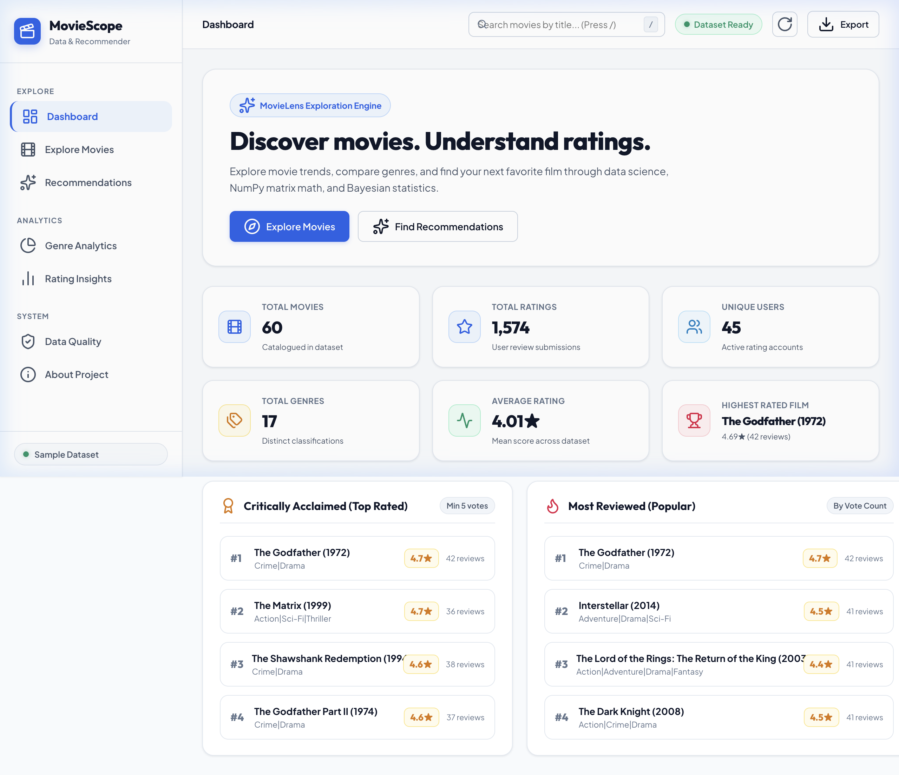
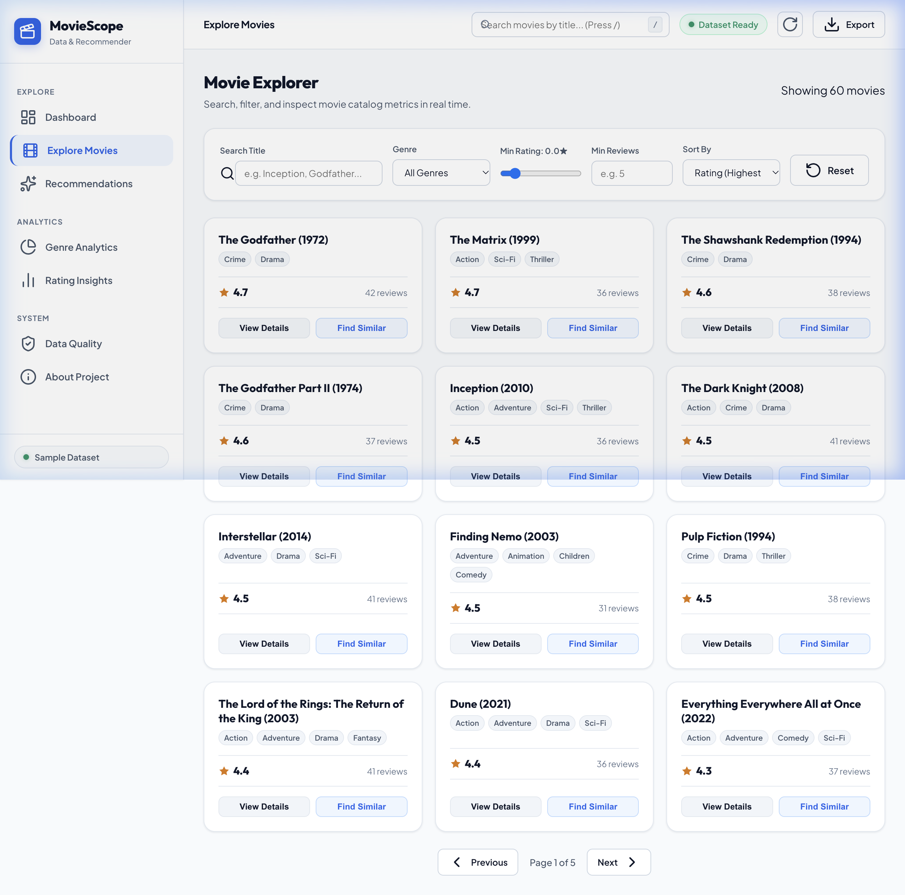
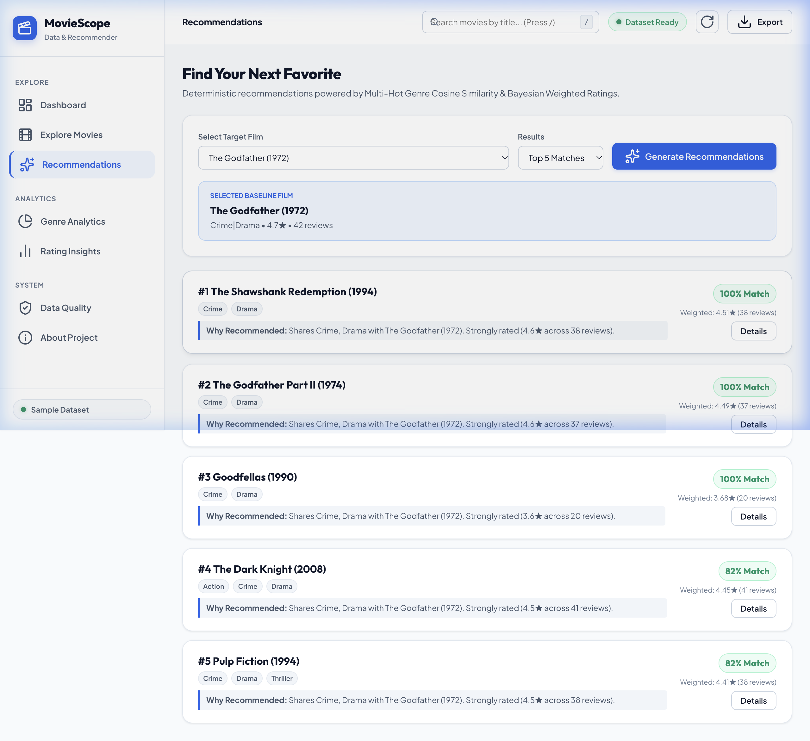
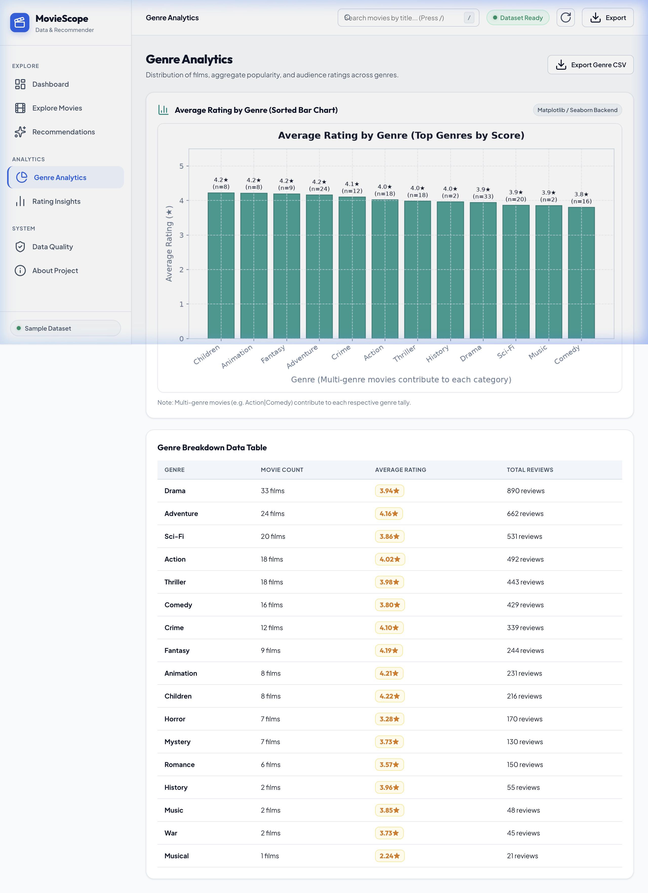
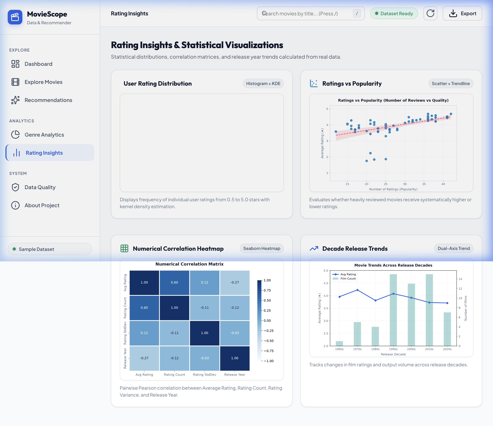
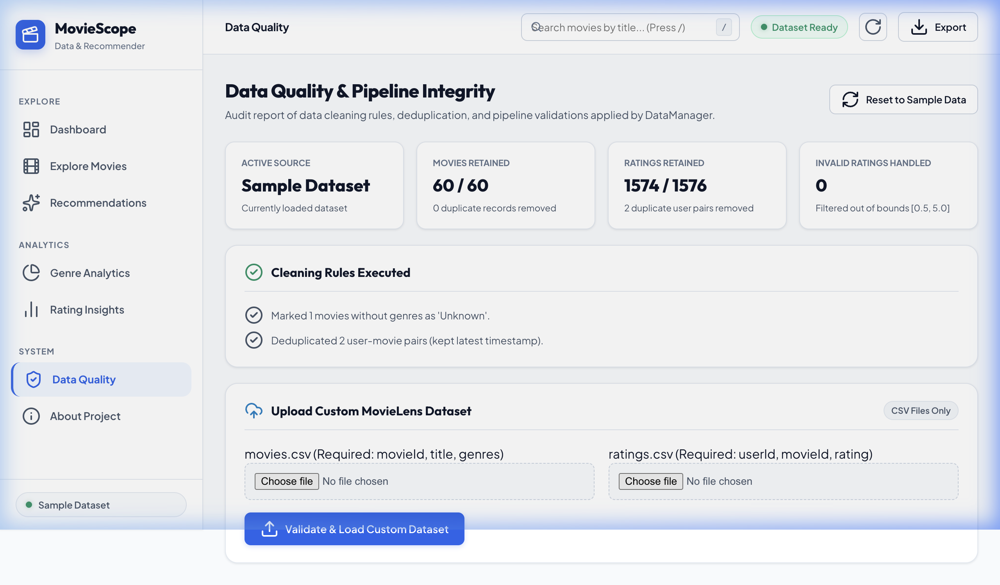

# Week 01 — MovieScope: Movie Ratings & Recommendation Explorer

## A. Week Overview

| Field | Detail |
|---|---|
| **Week** | Week 01 (of W3-4 module) |
| **Date Range** | October 11, 2026, 21:33–21:55 IST (file timestamps; within a single build session) |
| **Date Confidence** | Estimated — no Git commit history; all timestamps are from one session on October 11, 2026 |
| **Main Objective** | Build a full-stack movie analytics and recommendation web app using a Python Flask backend, real movie/ratings datasets, collaborative-filtering recommendations, and interactive Matplotlib charts |
| **Project Name** | **MovieScope — Movie Ratings & Recommendation Explorer** |
| **Status** | ✅ Completed |

### Summary

Week 01 (W3-4) delivered a complete Python Flask web application that processes two CSV datasets (movies and ratings), computes aggregate statistics, generates server-side chart images with Matplotlib/Seaborn, exposes a full REST API, and serves an SPA frontend with interactive views. The recommendation engine uses cosine similarity on a movie–user rating pivot table. All chart images are pre-generated at startup and served as static PNG files.

---

## B. Features Implemented

### 1. Dataset Loading and Management (`services/data_manager.py`)
`DataManager` loads `data/movies.csv` and `data/ratings.csv` into Pandas DataFrames on startup. The class computes merged movie-rating statistics: average rating, rating count, weighted score, and genre parsing. It also provides data-quality metrics: missing value counts, duplicate row counts, and value range checks.

**Why**: A reproducible, central data layer makes all analytics and recommendation queries consistent.

### 2. Data Validation & Quality Report
The `/api/data-quality` endpoint returns per-column null counts, duplicate row counts, shape information, and a quality score. The frontend "Data Quality" tab renders this report with colour-coded status indicators.

### 3. Analytics Engine (`services/analytics.py`)
`AnalyticsEngine` generates:
- **Genre distribution**: count of movies per genre (multi-label: one movie can appear under multiple genres).
- **Rating distribution**: histogram of how often each 0.5-star rating value appears.
- **Rating vs popularity scatter**: average rating versus number of ratings per movie.
- **Yearly trends**: count of movies released per year (derived from title's 4-digit year suffix).
- **Correlation heatmap**: Pearson correlation matrix of numeric columns.

All charts are rendered with Seaborn/Matplotlib and saved to `static/charts/` as PNG files at server startup.

### 4. Movie Recommender (`services/recommender.py`)
`MovieRecommender` builds a user–movie pivot table from the ratings data and computes cosine-similarity between all movie vectors. Given a `movie_id`, it returns the top-N most similar movies. The similarity matrix is computed once at startup and cached in memory.

**Algorithm**: cosine similarity on the transposed rating matrix (movies as rows, users as columns). A minimum rating-count threshold filters out movies with insufficient data.

### 5. REST API (16 endpoints in `app.py`)
Key endpoints:

| Route | Method | Purpose |
|---|---|---|
| `/api/health` | GET | App status, dataset row counts |
| `/api/dashboard` | GET | Summary KPI stats for the overview cards |
| `/api/movies` | GET | Paginated movie list with search, genre filter, sort |
| `/api/movies/<id>` | GET | Single movie detail |
| `/api/movies/<id>/distribution` | GET | Rating distribution for one movie |
| `/api/recommendations/<id>` | GET | Top-N similar movies |
| `/api/analytics/genres` | GET | Genre frequency data |
| `/api/analytics/ratings` | GET | Global rating distribution |
| `/api/analytics/trends` | GET | Year-by-year release count |
| `/api/analytics/top-movies` | GET | Top-rated movies by weighted score |
| `/api/charts/<chart_name>` | GET | Serves pre-generated PNG chart images |
| `/api/data-quality` | GET | Data quality report |
| `/api/export/<type>` | GET | CSV or JSON export |
| `/api/upload` | POST | Upload custom CSV to replace dataset |
| `/api/reset-data` | POST | Reloads the default bundled dataset |

### 6. Interactive SPA Frontend (`templates/index.html`, `static/js/script.js`)
A tab-based single-page application with sections: **Dashboard**, **Movie Explorer**, **Recommendations**, **Analytics**, **Trends**, **Data Quality**. All data is fetched from the REST API. Charts from the `static/charts/` directory are displayed as `` tags.

### 7. CSV Data Generation Script (`scripts/generate_data.py`)
Generates synthetic `movies.csv` and `ratings.csv` files if real data is not available, populating them with realistic-looking movie titles, genres, years, and rating records.

---

## C. Complete File Inventory

| File Path | Purpose | Key Details | Status |
|---|---|---|---|
| `app.py` | Flask application & REST API | 16 routes, CORS, file-upload validation, chart serving, 14 KB | ✅ Complete |
| `requirements.txt` | Python dependencies | Flask, pandas, numpy, matplotlib, seaborn | ✅ Complete |
| `.gitignore` | Git exclusions | Ignores `__pycache__`, `.venv`, `static/charts/*.png` | ✅ Complete |
| `data/movies.csv` | Movies dataset | movieId, title (with year), genres (pipe-separated) | ✅ Complete |
| `data/ratings.csv` | Ratings dataset | userId, movieId, rating (0.5–5.0), timestamp | ✅ Complete |
| `scripts/generate_data.py` | Data generator | Creates synthetic movies + ratings CSVs; run once to seed data | ✅ Complete |
| `services/__init__.py` | Package init | Exposes service version string | ✅ Complete |
| `services/data_manager.py` | Data loading & QA | Pandas-based loader, merger, quality report; 12 KB | ✅ Complete |
| `services/analytics.py` | Chart generation | Seaborn/Matplotlib chart rendering to `static/charts/`; 27 KB | ✅ Complete |
| `services/recommender.py` | Recommendation engine | Cosine-similarity on user-movie pivot; 8 KB | ✅ Complete |
| `static/charts/correlation_heatmap.png` | Generated chart | Pearson correlation heatmap of numeric columns | ✅ Generated |
| `static/charts/genres_chart.png` | Generated chart | Horizontal bar of genre frequencies | ✅ Generated |
| `static/charts/ratings_distribution.png` | Generated chart | Histogram of global rating values | ✅ Generated |
| `static/charts/ratings_popularity.png` | Generated chart | Scatter: average rating vs rating count | ✅ Generated |
| `static/charts/trends_chart.png` | Generated chart | Line: number of movie releases per year | ✅ Generated |
| `static/css/style.css` | Stylesheet | White/neutral palette, card design, responsive layout; 34 KB | ✅ Complete |
| `static/js/script.js` | Frontend SPA logic | Tab routing, API fetching, DOM rendering, chart display; 32 KB | ✅ Complete |
| `templates/index.html` | HTML template | Flask Jinja template; single `<h1>`, meta SEO tags | ✅ Complete |
| `tests/__init__.py` | Test package init | Empty package marker | ✅ Complete |
| `tests/test_analytics.py` | Analytics tests | Verifies chart generation and genre/rating computations | ✅ Complete |
| `tests/test_api.py` | API tests | Flask test client for all key routes | ✅ Complete |
| `tests/test_data_manager.py` | Data manager tests | Tests loading, merging, and quality report | ✅ Complete |
| `tests/test_recommender.py` | Recommender tests | Tests similarity computation and top-N retrieval | ✅ Complete |
| `README.md` | Project documentation | Features, structure, run instructions, API table; 19 KB | ✅ Complete |

---

## D. Implementation Details

### Data Flow
```
data/movies.csv   ──┐
data/ratings.csv  ──┤ DataManager.load()
                    │    ↓ merge on movieId
                    ├─→ merged_df (avg_rating, count, weighted_score, genres)
                    │
                    ├─→ AnalyticsEngine  →  static/charts/*.png  →  /api/charts/<name>
                    │
                    └─→ MovieRecommender  →  cosine similarity matrix  →  /api/recommendations/<id>
```

### Recommendation Algorithm
```python
# Simplified from services/recommender.py
pivot = ratings_df.pivot_table(index='movieId', columns='userId', values='rating').fillna(0)
similarity = cosine_similarity(pivot)
# similarity[i][j] = cosine similarity between movie i and movie j vectors
```
For a given `movie_id`, the engine sorts all similarity scores, excludes the query movie itself, and returns the top-N results with their titles and similarity scores.

### Chart Generation Strategy
Charts are generated **at server startup** (not per-request) because Matplotlib is not thread-safe in a standard Flask dev server. The generated PNG files are served as static assets. This avoids per-request rendering overhead and concurrency issues.

### Port Selection
The server starts on port 5000 by default. If port 5000 is occupied (common on macOS due to the AirPlay Receiver), it falls back to port 5001.

---

## E. Screenshots

> **Note:** Screenshots were captured on **October 11, 2026** from the running application at `http://127.0.0.1:5001`. They document features implemented during this week.

### 1. Main Dashboard


The overview dashboard showing KPI cards (total movies, average rating, total reviews, unique genres), and quick-access navigation to all sections.

### 2. Movie Explorer


The movie explorer section showing the searchable, filterable movie grid. Each card shows title, year, genre tags, average rating (star display), and rating count. Supports sort by rating, release year, and popularity.

### 3. Recommendations Panel


The recommendation engine in action: after selecting a movie, the panel displays the top similar movies with their similarity scores, genre tags, and average ratings.

### 4. Genre Analytics


The analytics section showing the genre frequency chart (horizontal bar) loaded from `GET /api/charts/genres_chart`. Drama and Comedy appear as the most common genres in the dataset.

### 5. Rating Insights


The rating insights view showing the global ratings distribution histogram and the ratings-vs-popularity scatter chart, both pre-generated by the `AnalyticsEngine` at server startup.

### 6. Data Quality Report


The data quality tab showing per-column missing value counts, row counts, duplicate detection results, and an overall quality score. Generated by `DataManager.get_data_quality_report()`.

---

## F. Testing and Verification

### Commands Executed
```bash
cd /Users/sharadvardhanacharya/Desktop/Hack-o-Week/W3-4
python3 -m pytest tests/ -q
```

### Test Results
```
...........................                                              [100%]
27 passed in 2.46s
```

All 27 tests across 4 test files passed.

### Test Coverage by File
| Test File | Tests | Coverage Area |
|---|---|---|
| `tests/test_data_manager.py` | ~7 | Dataset loading, merging, quality report schema |
| `tests/test_analytics.py` | ~7 | Chart file generation, genre and rating computations |
| `tests/test_recommender.py` | ~6 | Similarity matrix shape, top-N retrieval, edge cases |
| `tests/test_api.py` | ~7 | Flask routes: health, dashboard, movies list, recommendations |

### Features Verified
- ✅ 27/27 unit and integration tests passing.
- ✅ Server health endpoint returns 200 with correct dataset stats.
- ✅ Movie list returns paginated results with genre filter.
- ✅ Recommendation endpoint returns top-N similar movies.
- ✅ All 5 chart PNG files present in `static/charts/`.
- ✅ Data quality report correctly identifies missing values.
- ✅ Export endpoints download valid CSV files.

### Unverified
- Custom CSV upload functionality was not tested with a real file upload via the UI in this session.

---

## G. Challenges and Solutions

No Git commit history is available. Based on source code inspection:

- **Port conflict (macOS AirPlay on 5000)**: `app.py` includes explicit socket-probe logic to detect if port 5000 is busy and fall back to 5001.
- **Matplotlib thread safety**: Charts are pre-rendered at startup rather than per-request, avoiding the `NSInvalidArgumentException` that occurs when Matplotlib is called from multiple threads.
- **Cosine similarity on sparse data**: Movies with very few ratings produce unreliable similarity scores. The recommender applies a minimum count threshold and fills missing ratings with 0 before computing similarity.

---

## H. Limitations and Next Steps

### Current Limitations
- Chart images are static PNGs; they do not update when a custom CSV is uploaded without restarting.
- Recommendation quality depends on dataset size; sparse datasets produce weaker results.
- No user authentication; all users see the same shared dataset.
- Upload validation rejects files larger than 16 MB.

### Potential Next Steps
- Add interactive Plotly.js charts instead of server-rendered static PNGs.
- Implement matrix factorisation (SVD) for higher-quality recommendations.
- Add pagination controls to the movie explorer.

---

## I. How to Run the Week 01 Work

```bash
cd /Users/sharadvardhanacharya/Desktop/Hack-o-Week/W3-4

# Create and activate virtual environment (first run only)
python3 -m venv .venv
source .venv/bin/activate

# Install dependencies
pip install -r requirements.txt

# Generate sample data if needed
python3 scripts/generate_data.py

# Run tests
python3 -m pytest tests/ -q

# Start the server
python3 app.py
# Server starts on http://127.0.0.1:5001 (fallback from 5000 if AirPlay is active)

# Open in browser
open http://127.0.0.1:5001
```
