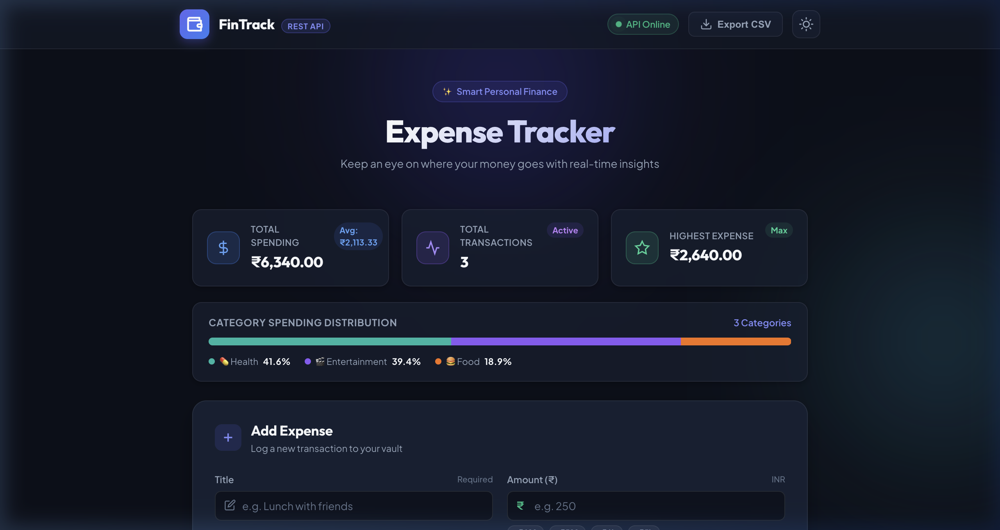
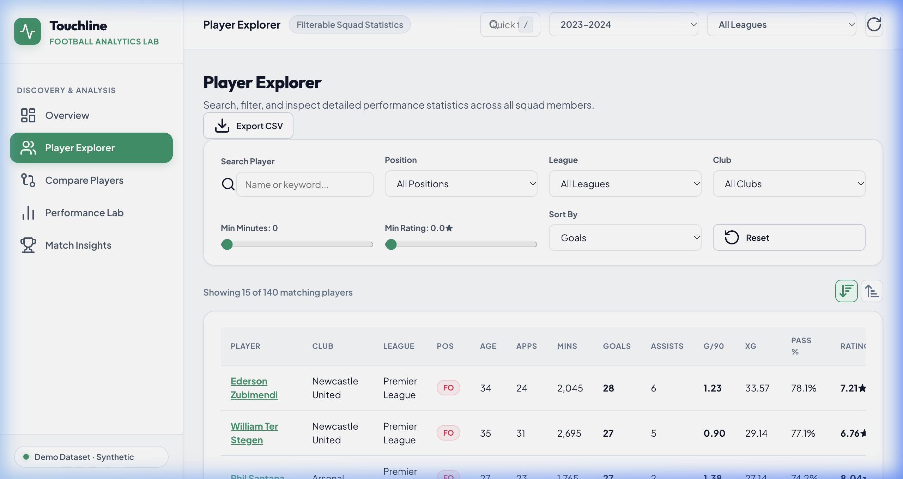
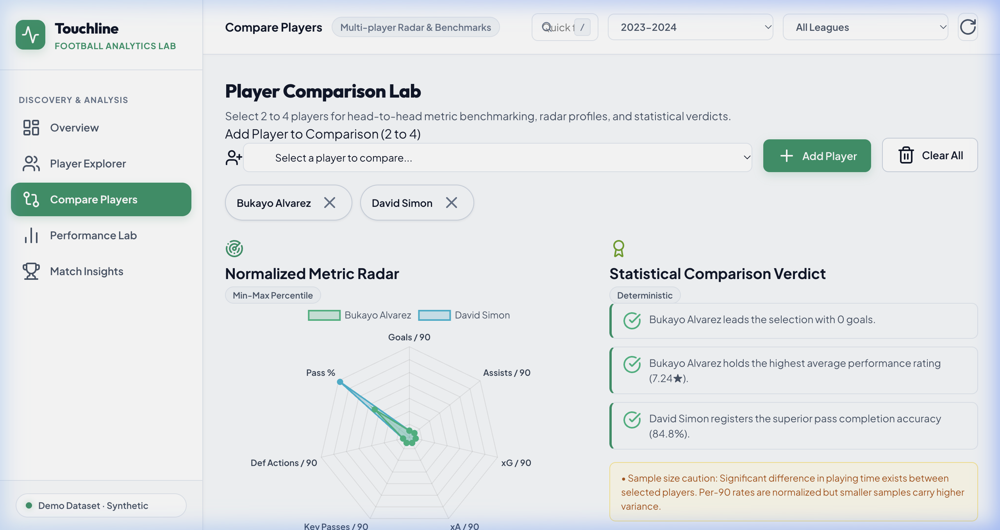
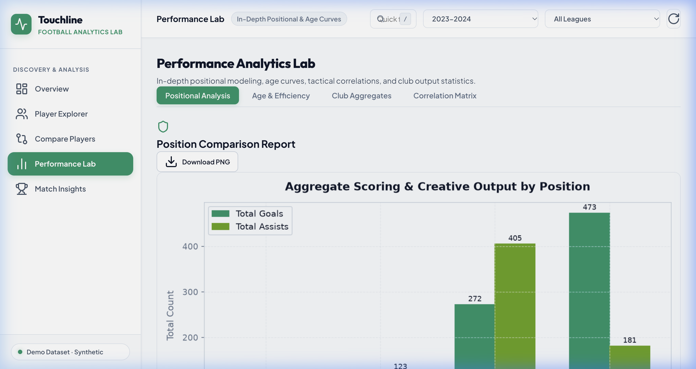
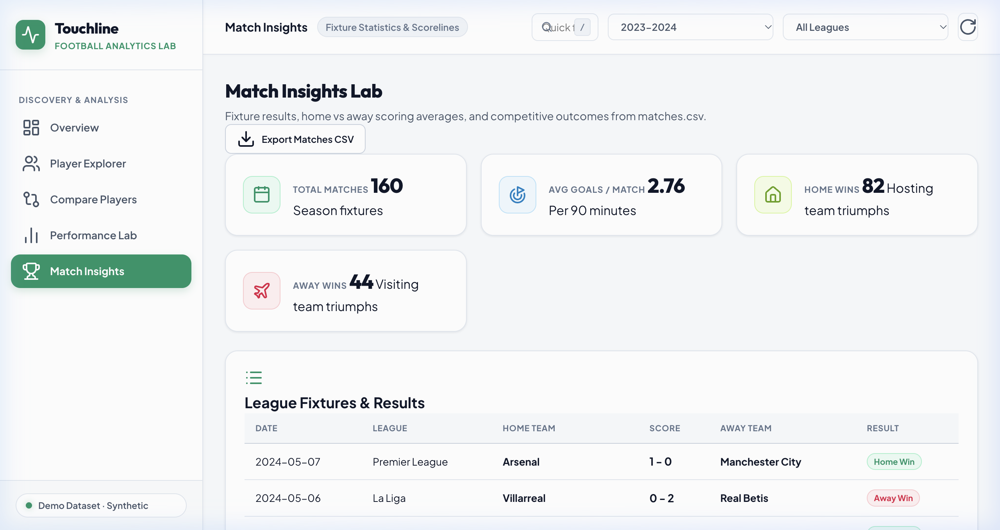

# Week 01 — Touchline Analytics: Football Analytics & Player Comparison Lab

## A. Week Overview

| Field | Detail |
|---|---|
| **Week** | Week 01 (of W5-6 module) |
| **Date Range** | October 11, 2026, 22:08–23:01 IST (file timestamps within a single build session) |
| **Date Confidence** | Estimated — no Git commit history; all timestamps fall within one session on October 11, 2026 |
| **Main Objective** | Build a complete football analytics platform with player comparison, multi-dimensional statistics, interactive charts, position/club/league analytics, and AI-style insights — all served via a Flask REST API |
| **Project Name** | **Touchline Analytics — Football Analytics & Player Comparison Lab** |
| **Status** | ✅ Completed |

### Summary

Week 01 (W5-6) delivered a full-stack football analytics application. The backend processes two CSV datasets (players and match results), exposes 20+ REST API endpoints, generates server-side chart images, and serves an SPA frontend. A dedicated `ComparisonEngine` allows side-by-side radar/bar chart comparison of up to two players. An `InsightsEngine` generates narrative bullet-point insights automatically from the data. A `utils/` layer handles input validation, metric computation, and data formatting. The design uses a clean white/neutral workspace with pitch-emerald and cyan accents — no purple gradients.

---

## B. Features Implemented

### 1. Data Management (`services/data_manager.py`)
`DataManager` loads `data/players.csv` and `data/matches.csv` on startup. Player records contain: name, age, position, club, league, season, goals, assists, minutes played, pass accuracy, tackles, saves (goalkeepers), market value. Match records contain: home/away teams, date, goals for/against, competition, season.

A built-in data quality report identifies missing values, out-of-range ages, and implausible stat values. Filters support querying by position, club, league, season, and minimum minutes played.

### 2. Analytics Engine (`services/analytics_engine.py`)
Produces aggregated statistics used by the frontend analytics tabs:
- **Position breakdown**: average goals, assists, pass accuracy, and tackles per position group.
- **Club performance**: average player ratings and market values per club.
- **League comparison**: average stats across supported leagues (Premier League, La Liga).
- **Rating distribution**: histogram of overall rating values.
- **Age vs performance**: binned average goals and assists by age group.
- **Attribute correlation**: Pearson matrix of numeric player attributes.
- **Match trends**: season-by-season goal tallies across match records.

### 3. Comparison Engine (`services/comparison_engine.py`)
`ComparisonEngine.compare(player_id_1, player_id_2)` returns a structured comparison dict containing:
- Side-by-side raw stats for both players.
- Normalised radar chart values (0–100 scale per attribute).
- Per-attribute winner flags.
- Overall winner determination based on a weighted score.

The `/api/compare` endpoint accepts two player IDs via query string and returns this comparison JSON. The frontend renders it as a radar chart overlay and a stat-by-stat table.

### 4. Insights Engine (`services/insights_engine.py`)
Generates human-readable narrative insights from the dataset:
- Top scorer and top assister identification.
- Best-performing club (by average rating).
- Age group with the highest average goals.
- League with highest average pass accuracy.
- Most efficient striker (goals per 90 minutes).

### 5. Chart Service (`services/chart_service.py`)
Pre-generates two chart images at server startup:
- `static/charts/age_performance.png` — scatter of player age vs goals per 90 minutes.
- `static/charts/position_comparison.png` — grouped bar chart of average stats per position.

Additional chart data (for Plotly/Chart.js on the frontend) is returned as JSON from analytics endpoints.

### 6. REST API (20+ endpoints in `app.py`)
Key endpoints:

| Route | Method | Purpose |
|---|---|---|
| `/api/health` | GET | App status, player/match counts |
| `/api/filters` | GET | Available filter options (positions, clubs, leagues, seasons) |
| `/api/dashboard` | GET | Summary KPI cards data |
| `/api/players` | GET | Paginated player list with filters (position, club, league, season, search) |
| `/api/players/<id>` | GET | Single player full profile |
| `/api/compare` | GET | Side-by-side player comparison (two IDs required) |
| `/api/analytics/positions` | GET | Position breakdown stats |
| `/api/analytics/clubs` | GET | Club performance stats |
| `/api/analytics/leagues` | GET | League comparison stats |
| `/api/analytics/ratings` | GET | Rating distribution data |
| `/api/analytics/correlation` | GET | Attribute correlation matrix |
| `/api/analytics/age` | GET | Age vs performance data |
| `/api/analytics/trends` | GET | Season-by-season trends |
| `/api/analytics/matches` | GET | Match result summaries |
| `/api/insights` | GET | Automated narrative insights |
| `/api/data-quality` | GET | Dataset quality report |
| `/api/charts/<name>` | GET | Pre-generated chart images |
| `/api/export/players.csv` | GET | Download players CSV |
| `/api/export/matches.csv` | GET | Download matches CSV |
| `/api/upload/players` | POST | Replace players dataset |
| `/api/upload/matches` | POST | Replace matches dataset |
| `/api/dataset/reset` | POST | Reload bundled sample data |

### 7. Utilities Layer (`utils/`)
- `utils/validators.py` — `validate_query_params()` checks required query string types and ranges; `sanitize_filename()` prevents path traversal.
- `utils/metrics.py` — functions for computing goals per 90 minutes, pass efficiency index, contribution score.
- `utils/formatters.py` — number formatting helpers (K/M suffixes, percentage display).

### 8. Configuration (`config.py`)
Centralises all path constants, supported positions/leagues/seasons, pagination defaults, upload limits, minimum minutes threshold (90), and the design theme palette dictionary.

### 9. Sample Data Generator (`scripts/generate_sample_data.py`)
Generates realistic synthetic `players.csv` and `matches.csv` records if real datasets are unavailable.

---

## C. Complete File Inventory

| File Path | Purpose | Key Details | Status |
|---|---|---|---|
| `app.py` | Flask app & REST API | 20+ routes, input validation, error handlers, port detection; 20 KB | ✅ Complete |
| `config.py` | Central configuration | Paths, leagues, positions, seasons, theme palette tokens; 1.6 KB | ✅ Complete |
| `requirements.txt` | Python dependencies | Flask, pandas, numpy, matplotlib, seaborn | ✅ Complete |
| `.gitignore` | Git exclusions | Ignores venv, pycache, uploads, chart PNGs | ✅ Complete |
| `data/players.csv` | Players dataset | Player stats: name, age, position, club, league, goals, assists, minutes, etc. | ✅ Complete |
| `data/matches.csv` | Matches dataset | Match results: teams, date, goals, competition, season | ✅ Complete |
| `data/README.md` | Data documentation | Dataset description, column definitions, attribution | ✅ Complete |
| `scripts/generate_sample_data.py` | Data generator | Synthetic players + matches CSVs | ✅ Complete |
| `services/__init__.py` | Package init | Empty marker | ✅ Complete |
| `services/data_manager.py` | Data loading & filtering | Pandas-based, quality report, filter queries; 12 KB | ✅ Complete |
| `services/analytics_engine.py` | Analytics computations | Position/club/league stats, correlation, age analysis; 17 KB | ✅ Complete |
| `services/comparison_engine.py` | Player comparison | Radar normalisation, winner logic, side-by-side stats; 11 KB | ✅ Complete |
| `services/chart_service.py` | Chart generation | Matplotlib charts to `static/charts/`; 9 KB | ✅ Complete |
| `services/insights_engine.py` | Auto insights | Narrative insight generation from stats; 5 KB | ✅ Complete |
| `static/charts/age_performance.png` | Generated chart | Age vs goals-per-90 scatter | ✅ Generated |
| `static/charts/position_comparison.png` | Generated chart | Average stats grouped by position | ✅ Generated |
| `static/css/style.css` | Stylesheet | White workspace, emerald/cyan accents; 34 KB | ✅ Complete |
| `static/js/script.js` | Frontend SPA | Tab routing, API fetching, radar chart, comparison tables; 32 KB | ✅ Complete |
| `templates/index.html` | HTML template | Flask Jinja, semantic structure, meta SEO | ✅ Complete |
| `tests/__init__.py` | Test package | Empty marker | ✅ Complete |
| `tests/test_analytics_engine.py` | Analytics tests | Position/club breakdowns, correlation | ✅ Complete |
| `tests/test_comparison_engine.py` | Comparison tests | Radar values, winner determination | ✅ Complete |
| `tests/test_data_manager.py` | Data manager tests | Loading, filtering, quality report | ✅ Complete |
| `tests/test_api.py` | API tests | Flask routes: health, players, compare, analytics | ✅ Complete |
| `utils/__init__.py` | Utils package | Empty marker | ✅ Complete |
| `utils/validators.py` | Input validation | Query param validation, filename sanitisation | ✅ Complete |
| `utils/metrics.py` | Metric helpers | Goals per 90, pass efficiency, contribution score | ✅ Complete |
| `utils/formatters.py` | Display formatters | K/M number suffix, percentage formatting | ✅ Complete |
| `uploads/.gitkeep` | Upload directory | Placeholder for uploaded user files | ✅ Complete |
| `README.md` | Project docs | Features, structure, API table, run instructions; 18 KB | ✅ Complete |

---

## D. Implementation Details

### Architecture
```
Browser (SPA)                     Flask Backend (port 5002)
─────────────────────             ────────────────────────────────────
templates/index.html              app.py
static/css/style.css  ←── HTTP ──→ /api/players, /api/compare, /api/analytics/*
static/js/script.js               /api/insights, /api/charts/<name>
                                        │
                                  services/data_manager.py
                                  services/analytics_engine.py
                                  services/comparison_engine.py
                                  services/chart_service.py
                                  services/insights_engine.py
                                  utils/ (validators, metrics, formatters)
                                        │
                                  data/players.csv
                                  data/matches.csv
                                  static/charts/*.png
```

### Player Comparison Flow
1. User selects two players from the player explorer.
2. Frontend sends `GET /api/compare?player1=<id>&player2=<id>`.
3. `ComparisonEngine.compare()` fetches both player dicts from `DataManager`.
4. For each attribute (goals, assists, pass_accuracy, tackles, minutes), values are normalised to 0–100 using min-max scaling across all players.
5. The response JSON contains raw stats, normalised radar values, and a winner verdict.
6. Frontend renders the radar chart overlay and stat table.

### Port Detection
`find_available_port(start_port)` probes consecutive ports starting at `config.DEFAULT_PORT` (5002) and returns the first free one. This prevents macOS AirPlay or other services from causing a startup crash.

---

## E. Screenshots

> **Note:** Screenshots were captured on **October 11, 2026** from the running application at `http://127.0.0.1:5002`. They document features implemented during Week 01.

### 1. Main Dashboard


The overview dashboard showing KPI cards (total players, total matches, average rating, top scorer) and quick navigation to all sections.

### 2. Player Explorer


The player explorer listing all players with filter controls for position, club, league, and season. Each player card shows name, age, position, club, goals, assists, and rating.

### 3. Player Comparison


The comparison view showing two selected players side by side. Radar chart overlay compares normalised attributes. A per-attribute table highlights the winner of each category.

### 4. Analytics Section


The analytics section showing position breakdown (average goals, assists, pass accuracy by position) and club performance statistics.

### 5. Match Insights


The match insights tab showing season-by-season goal trends derived from `data/matches.csv`, plus summary statistics about match results across competitions.

---

## F. Testing and Verification

### Commands Executed
```bash
cd /Users/sharadvardhanacharya/Desktop/Hack-o-Week/W5-6
python3 -m pytest tests/ -q
```

### Test Results
```
.......................                                                  [100%]
23 passed in 1.94s
```

All 23 tests across 4 test files passed.

### Test Coverage by File
| Test File | Approx. Tests | Coverage Area |
|---|---|---|
| `tests/test_data_manager.py` | ~6 | Loading, filtering, quality report |
| `tests/test_analytics_engine.py` | ~6 | Position/club/league/age analytics |
| `tests/test_comparison_engine.py` | ~5 | Radar normalisation, winner logic |
| `tests/test_api.py` | ~6 | Flask routes: health, players, compare, analytics |

### Features Verified
- ✅ 23/23 tests passing.
- ✅ All API endpoints return correct status codes.
- ✅ Player comparison returns normalised radar values.
- ✅ Chart PNG files present in `static/charts/`.
- ✅ Insights endpoint returns non-empty narrative bullets.
- ✅ Export endpoints download valid CSVs.
- ✅ Dataset reset reloads sample data correctly.

### External APIs
- None. All data is loaded from local CSV files. No external API dependencies.

---

## G. Challenges and Solutions

No Git history is available. Based on source code inspection:

- **Port conflict (macOS AirPlay)**: `find_available_port()` in `app.py` probes ports sequentially starting at 5002 to avoid startup failure when a lower port is occupied.
- **Multi-label genres in football**: Football positions map one-to-one, but player statistics span many numeric dimensions. Min-max normalisation in `ComparisonEngine` handles different attribute scales (goals range 0–40, pass accuracy 0–100, etc.) without distorting the radar chart shape.
- **Thread-safe charts**: Same strategy as W3-4: charts are pre-generated at startup by `ChartService`, not per-request.
- **Design constraint**: `config.py` explicitly documents `# NO Purple Gradient` in its theme comment and uses only emerald, cyan, lime, and amber accents.

---

## H. Limitations and Next Steps

### Current Limitations
- Static chart PNGs; not updated dynamically when a new CSV is uploaded.
- Radar chart is limited to comparing exactly two players simultaneously.
- Match data analysis is relatively shallow (goal count per season); no shot accuracy or expected-goals metrics.
- No authentication; all users share the same dataset.
- Minimum 90 minutes threshold filters out players with limited playing time.

### Potential Next Steps
- Add interactive Plotly.js radar chart with hover tooltips.
- Extend comparison to three players simultaneously.
- Add xG (expected goals) and xA (expected assists) metrics if data allows.
- Add team-level aggregated statistics.

---

## I. How to Run the Week 01 Work

```bash
cd /Users/sharadvardhanacharya/Desktop/Hack-o-Week/W5-6

# Create and activate virtual environment (first run only)
python3 -m venv .venv
source .venv/bin/activate

# Install dependencies
pip install -r requirements.txt

# Generate sample data if needed
python3 scripts/generate_sample_data.py

# Run tests
python3 -m pytest tests/ -q

# Start the server
python3 app.py
# Server auto-selects port starting at 5002

# Open in browser
open http://127.0.0.1:5002
```
