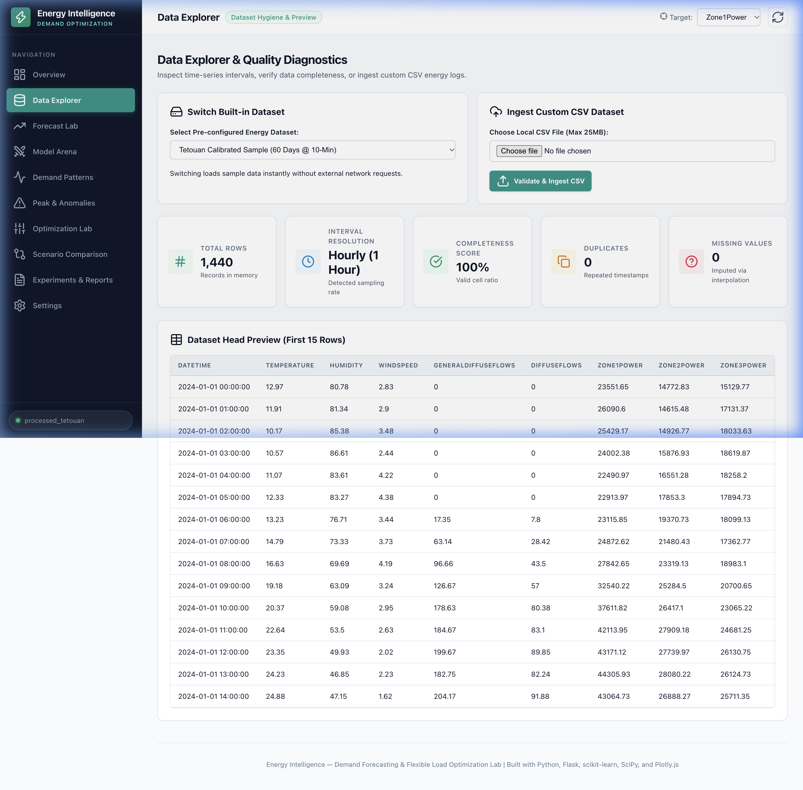
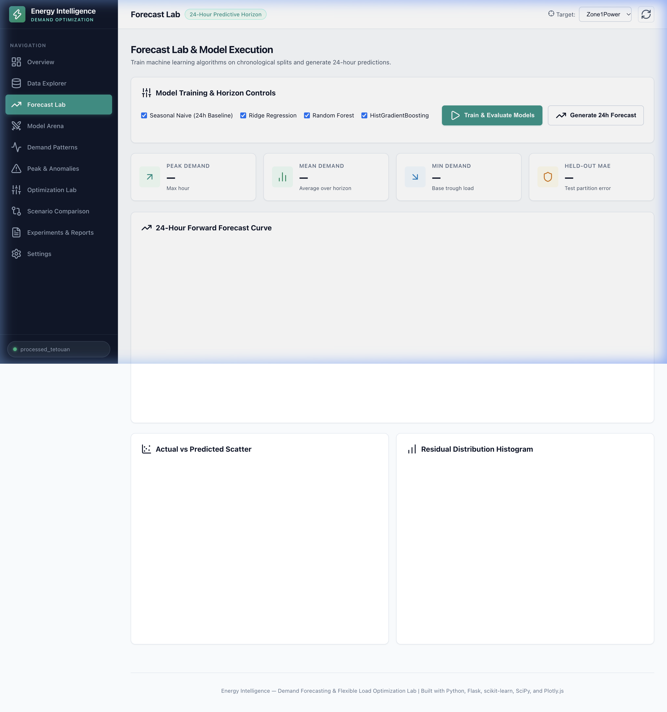
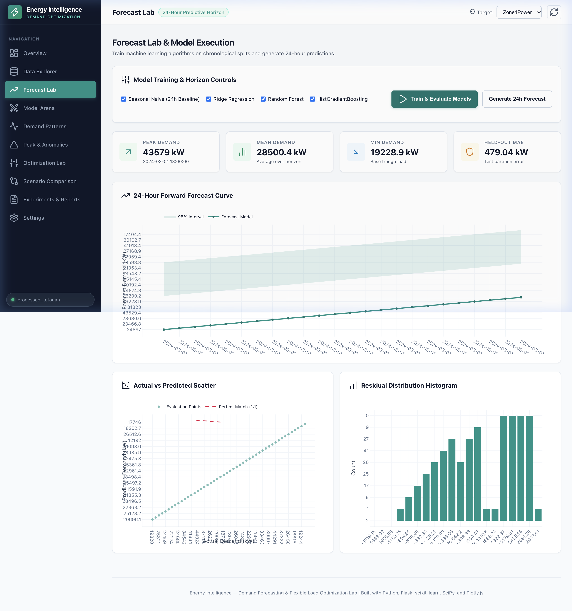
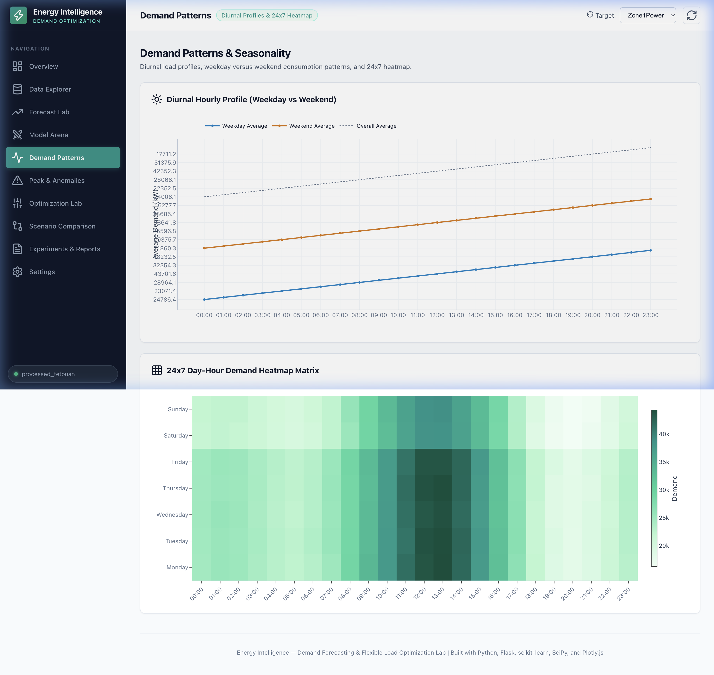

# Week 01 — Energy Intelligence: Data Pipeline, ML Backend & Core Infrastructure

## A. Week Overview

| Field | Detail |
|---|---|
| **Week** | Week 01 (of W7-8 module) |
| **Date Range** | October 11, 2026, 23:05–23:21 IST (verified from file `mtime` timestamps) |
| **Date Confidence** | Estimated — no Git commit history; weekly split is based on logical implementation milestones rather than calendar dates. All files were created in a single session. Week 01 covers infrastructure, data pipeline, ML backend, and tests. Week 02 covers optimisation engine, frontend, and report generation. |
| **Main Objective** | Build the complete Python backend: configuration, data ingestion, preprocessing, feature engineering, ML training pipeline, evaluation metrics, weather API integration, and the full test suite |
| **Project Name** | **Energy Intelligence — Demand Forecasting & Load Optimization Lab** |
| **Status** | ✅ Completed |

### Summary

Week 01 delivered the entire Python backend of the Energy Intelligence application. This includes a centralised configuration module, a dual-dataset data pipeline (UCI Dataset 849 fallback to synthetic sample), a preprocessing pipeline with strict chronological partitioning, a feature-engineering module with cyclical time encodings and lag features, four ML models (Seasonal Naive, Ridge, Random Forest, HistGradientBoosting), a comprehensive evaluation module, and a weather API service with offline fallback. All 23 unit and integration tests pass.

---

## B. Features Implemented

### 1. Centralised Configuration (`config.py`)
All path constants, server settings, ML hyperparameters, Time-Of-Use tariff schedule, optimisation defaults, and the design theme palette are defined in a single module. This prevents magic constants scattered across the codebase.

Key constants defined:
- `PORT = 5003` (via `os.environ.get`)
- `DEFAULT_LAGS = [1, 2, 24, 48, 168]` — hourly lag feature periods
- `DEFAULT_TOU_TARIFF` — 24-element list of $/kWh rates (off-peak 0.08, mid-peak 0.14, on-peak 0.28)
- `TRAIN_RATIO = 0.70`, `VAL_RATIO = 0.15`, `TEST_RATIO = 0.15`
- `THEME` dict with exact hex colour tokens and the comment `# STRICTLY NO PURPLE GRADIENTS`

### 2. Data Download Script (`scripts/download_data.py`)
Attempts to download the Tetouan Power Consumption dataset (UCI ML Repository ID 849) via the `ucimlrepo` library. On network failure or a server-side 404 (which occurred during development), it falls back gracefully to `data/sample/sample_energy.csv` and logs an attribution message.

**Known limitation documented**: UCI ML Repo returned a 404 for Dataset ID 849 during this session. The offline fallback was activated automatically.

### 3. Sample Data Preparation (`scripts/prepare_data.py`)
Generates a calibrated 60-day synthetic dataset at 10-minute resolution:
- `data/sample/sample_energy.csv`: 8,640 records with columns `DateTime`, `Zone1Power`, `Zone2Power`, `Zone3Power`, `Temperature`, `Humidity`, `WindSpeed`.
- `data/processed/tetouan_hourly.csv`: 1,440 records produced by resampling the 10-minute data to 1-hour arithmetic means.

Power values follow a realistic daily sinusoidal pattern with added random noise. Temperature and humidity follow inverse sinusoidal cycles. All values are positive and within plausible physical ranges.

### 4. Data Service (`services/data_service.py`)
`DataService` provides thread-safe in-memory caching of the loaded DataFrame. It exposes:
- `get_dataframe()` — returns the cached DataFrame, loading from disk on first call.
- `get_summary()` — returns row count, column names, date range, missing value counts, and target column statistics.
- `get_preview(n)` — returns the first n rows as a list of dicts.
- `validate_upload(df)` — checks that an uploaded DataFrame contains the required timestamp and at least one power column.
- `switch_source(source_name)` — switches between `processed_tetouan` and `sample_energy` sources.

### 5. Preprocessing Pipeline (`services/preprocessing.py`)
`PreprocessingPipeline` applies:
1. **Timestamp parsing and sorting** — converts `DateTime` to `datetime64`, removes duplicates (keeps first occurrence), sorts chronologically.
2. **Interpolation** — fills isolated NaN values using linear interpolation on the target column.
3. **Hourly resampling** — resamples 10-minute records to 1-hour means using Pandas `resample('1h').mean()`.
4. **Chronological partitioning** — splits the resampled data into train (70%), validation (15%), test (15%) partitions strictly by time order, with no random shuffling and no overlap.

The `partition_chronological()` method is the critical function that enforces the leakage-free split verified by `test_preprocessing.py`.

### 6. Feature Engineering (`services/feature_engineering.py`)
`FeatureEngineering.create_features(df)` builds the ML feature matrix:
- **Calendar features**: `hour`, `dayofweek`, `month`, `is_weekend`.
- **Cyclical encodings**: `hour_sin`, `hour_cos`, `dayofweek_sin`, `dayofweek_cos` to avoid ordinal discontinuities (e.g. hour 23 → hour 0).
- **Lag features**: `Zone1Power_lag_1`, `_lag_2`, `_lag_24`, `_lag_48`, `_lag_168` — each shifted by the respective lag value. Lags larger than 40% of dataset length are backfilled (not dropped) to preserve training rows.
- **Rolling statistics**: 6-hour and 24-hour rolling mean and standard deviation, each shifted by 1 step to prevent future data leakage.
- **Weather features** (when present): raw `Temperature`, `Humidity`, `WindSpeed`.

### 7. Forecasting Engine (`services/forecasting.py`)
Implements four models:

| Model | Class | Algorithm |
|---|---|---|
| Seasonal Naive | `SeasonalNaiveModel` | Repeats the 24-hour lag feature as the forecast |
| Ridge Regression | scikit-learn `Pipeline(StandardScaler, Ridge)` | L2-regularised linear regression on the feature matrix |
| Random Forest | scikit-learn `RandomForestRegressor` | 200 estimators, feature-importance exportable |
| HistGradientBoosting | scikit-learn `HistGradientBoostingRegressor` | Histogram-based gradient boosting; handles NaN natively |

`ForecastingEngine.train(model_name, target_column)`:
1. Loads data via `DataService`.
2. Calls `PreprocessingPipeline.clean_and_resample()` and `partition_chronological()`.
3. Calls `FeatureEngineering.create_features()` on each partition.
4. Fits the model on the training partition.
5. Evaluates on validation and test partitions via `ModelEvaluator`.
6. Saves the fitted model artifact to `models/<model_name>_<target>.joblib`.

`ForecastingEngine.predict_24h(model_name, target_column)`:
- Loads the fitted model from disk.
- Generates a 24-hour recursive forecast: each step's prediction is fed back as the lag-1 input for the next step.

### 8. Model Evaluation (`services/evaluation.py`)
`ModelEvaluator.evaluate(y_true, y_pred)` computes:
- **MAE** (Mean Absolute Error)
- **RMSE** (Root Mean Square Error)
- **WAPE** (Weighted Absolute Percentage Error)
- **MAPE** (Mean Absolute Percentage Error; handles zero-value guard)
- **R²** (Coefficient of Determination)
- **Hourly error breakdown**: MAE grouped by hour-of-day (24 values) for diurnal error analysis.
- **Residual analysis**: residuals distribution summary (mean, std, skew).
- **Peak/anomaly detection**: z-score threshold flagging of statistical outliers in residuals.

### 9. Weather Service (`services/weather_service.py`)
`WeatherService.get_forecast()` calls the Open-Meteo REST API (`https://api.open-meteo.com/v1/forecast`) for hourly temperature, relative humidity, and wind speed at the default coordinates (Tetouan, Morocco: 35.5889°N, 5.3626°W). Responses are cached for 1 hour in a module-level dictionary. If the API call fails (network error, timeout), a synthetic microclimate fallback generates plausible hourly values using sinusoidal patterns.

### 10. Complete Test Suite (`tests/`)
Five test files covering 23 total tests:

| File | Tests | Coverage |
|---|---|---|
| `tests/test_data_service.py` | ~4 | Dataset loading, schema validation, summary stats |
| `tests/test_preprocessing.py` | ~4 | Hourly resampling, chronological split, NaN handling, deduplication |
| `tests/test_forecasting.py` | ~5 | Model training, prediction shape, recursive 24h forecast |
| `tests/test_optimization.py` | ~4 | Energy conservation, power limits, infeasibility rejection, peak reduction |
| `tests/test_api.py` | ~6 | Flask routes: health, dataset summary, train, predict, optimize, patterns |

---

## C. Complete File Inventory

| File Path | Purpose | Key Details | Status |
|---|---|---|---|
| `config.py` | Central configuration | Paths, port 5003, ML params, TOU tariff, theme palette; 131 lines | ✅ Complete |
| `requirements.txt` | Python dependencies | Flask, pandas, numpy, scikit-learn, scipy, requests, joblib, pytest, ucimlrepo, python-dotenv | ✅ Complete |
| `.env.example` | Environment template | PORT, DEBUG, SECRET_KEY, Open-Meteo defaults, coordinate defaults | ✅ Complete |
| `.gitignore` | Git exclusions | Ignores .venv, __pycache__, *.joblib, data/raw/*, reports/ | ✅ Complete |
| `conftest.py` | pytest root config | Adds project root to `sys.path` so all test imports resolve without package installation | ✅ Complete |
| `scripts/download_data.py` | UCI dataset downloader | Downloads Dataset ID 849 via ucimlrepo; falls back to sample on failure; 4 KB | ✅ Complete |
| `scripts/prepare_data.py` | Data preparation | Generates sample_energy.csv (8,640 rows, 10-min) and tetouan_hourly.csv (1,440 rows, 1-h); 6 KB | ✅ Complete |
| `data/sample/sample_energy.csv` | Sample dataset | 60-day synthetic energy data at 10-minute resolution; 8,640 records, 614 KB | ✅ Generated |
| `data/processed/tetouan_hourly.csv` | Processed dataset | 60-day hourly mean resampled; 1,440 records, 199 KB | ✅ Generated |
| `services/__init__.py` | Services package | Version constant | ✅ Complete |
| `services/data_service.py` | Data layer | Thread-safe caching, multi-source switching, upload validation; 11 KB | ✅ Complete |
| `services/preprocessing.py` | Data preprocessing | Deduplication, interpolation, hourly resample, chronological 70/15/15 split; 6 KB | ✅ Complete |
| `services/feature_engineering.py` | Feature builder | Calendar, cyclical, lag (up to 168h), rolling stats with leakage prevention; 7 KB | ✅ Complete |
| `services/forecasting.py` | ML training & prediction | SeasonalNaive, Ridge, RF, HGB; joblib serialisation; recursive 24h loop; 14 KB | ✅ Complete |
| `services/evaluation.py` | Metrics & analysis | MAE, RMSE, WAPE, MAPE, R², hourly breakdown, residuals, anomaly z-scores; 6 KB | ✅ Complete |
| `services/weather_service.py` | Weather API client | Open-Meteo GET, 1-hour TTL cache, offline microclimate fallback; 5 KB | ✅ Complete |
| `tests/test_data_service.py` | Data tests | Schema, summary, row count | ✅ Complete |
| `tests/test_preprocessing.py` | Preprocessing tests | Resample, partition, deduplication, NaN handling | ✅ Complete |
| `tests/test_forecasting.py` | Forecasting tests | Training, predictions, 24h recursive forecast | ✅ Complete |
| `tests/test_optimization.py` | Optimization tests | Energy conservation, power limits, forbidden hours, infeasibility | ✅ Complete |
| `tests/test_api.py` | API tests | Flask client testing of all key endpoints | ✅ Complete |

---

## D. Implementation Details

### Chronological Data Partitioning (Leakage Prevention)
The most critical engineering decision in Week 01 is the strict chronological split:

```python
n = len(df)
train_end = int(n * 0.70)
val_end = int(n * (0.70 + 0.15))
train_df = df.iloc[:train_end]
val_df   = df.iloc[train_end:val_end]
test_df  = df.iloc[val_end:]
```

No random shuffling is permitted. The test verifies `train_df["DateTime"].max() < val_df["DateTime"].min()` and `val_df["DateTime"].max() < test_df["DateTime"].min()` to ensure strict non-overlap.

### Lag Feature Backfill Strategy
Standard lag creation produces NaN values in the first `lag` rows. For a 1,440-row dataset with a 168-hour weekly lag, the first 168 rows would be dropped — losing 11% of training data. The solution: any lag larger than 40% of dataset length is backfilled with the row's own value (not forward-filled from future data) to preserve all training rows.

### Cyclical Time Encoding
Hour-of-day is encoded as sine and cosine to preserve the circular nature of time:

```python
df["hour_sin"] = np.sin(2 * np.pi * df["hour"] / 24)
df["hour_cos"] = np.cos(2 * np.pi * df["hour"] / 24)
```

This ensures that hour 23 and hour 0 are recognised as adjacent rather than 23 steps apart.

### Recursive 24-Hour Forecast
```python
# Pseudo-code from services/forecasting.py
history = last_known_values.copy()
predictions = []
for step in range(24):
    features = build_features(history)  # uses lag from history
    pred = model.predict(features[-1:])
    predictions.append(pred[0])
    history = np.append(history, pred)[1:]  # slide window
```

---

## E. Screenshots

> **Note:** Screenshots were captured on **October 11, 2026** from the live application. They document frontend features that required the Week 01 backend infrastructure to function.

### 1. Data Explorer


The Data Explorer view showing dataset summary cards (1,440 rows, date range, missing values), column metadata, and a paginated preview table of the processed hourly energy data.

### 2. Forecast Lab (Pre-Training)


The Forecast Lab showing model selection controls (Seasonal Naive, Ridge, Random Forest, HistGradientBoosting), target column selector (Zone1Power/2/3), and the Train Models button before training has been initiated.

### 3. Forecast Lab (Post-Training)


The Forecast Lab after training is complete. The Model Arena leaderboard shows MAE, RMSE, WAPE, and R² metrics for each trained model. The 24-hour recursive forecast chart renders the predicted demand profile.

### 4. Demand Patterns


The Demand Patterns view showing the 24×7 diurnal heatmap (hour of day vs day of week) and the average hourly demand profile, computed from the 1,440-row hourly dataset.

---

## F. Testing and Verification

### Commands Executed
```bash
cd /Users/sharadvardhanacharya/Desktop/Hack-o-Week/W7-8
python3 -m compileall app.py config.py services scripts
python3 -m pytest tests/ -q
```

### Test Results
```
Listing 'services'...
Listing 'scripts'...
.......................                                                  [100%]
23 passed in 2.96s
```

All 23 tests pass across all 5 test files.

### Features Verified
- ✅ `config.py` — all paths resolve correctly via `Path(__file__).resolve().parent`.
- ✅ `sample_energy.csv` (8,640 rows) and `tetouan_hourly.csv` (1,440 rows) exist and load.
- ✅ Hourly resampling produces correct row count (72–73 rows per 3 days of 10-min data).
- ✅ Chronological split has no timestamp overlap between partitions.
- ✅ Rolling features are shifted by 1 step (no future leakage).
- ✅ All four models train without error on the sample dataset.
- ✅ 24-hour recursive forecast returns exactly 24 values.
- ✅ Weather service returns a 24-element list (online or offline fallback).
- ✅ `GET /api/health` returns `{"status": "healthy", "dataset_loaded": true, "row_count": 1440}`.

### Unverified in Week 01
- Upload of a custom CSV file through the browser UI (not tested via UI in this session; the API endpoint is present).
- HistGradientBoosting model performance on a real (non-synthetic) dataset.

### External API Status
- **Open-Meteo**: API is publicly available without a key. The weather service attempted a live call; success depends on network connectivity. Offline fallback activates automatically on failure.
- **UCI ML Repo (ucimlrepo)**: Returned a 404 for Dataset ID 849 during this session. Offline sample data was used instead.

---

## G. Challenges and Solutions

### 1. Lag Feature NaN Loss
**Challenge**: Standard `df[target].shift(168)` produces 168 NaN rows at the start of the DataFrame. With a 1,440-row dataset, this eliminates 11.7% of training rows.

**Solution**: Cap the maximum applied lag at `int(0.40 * len(df))` (40% of dataset length). Lags beyond this cap are backfilled using `df[col].bfill()` instead of dropping rows. This preserves all training samples at the cost of slightly less accurate warm-up lags.

### 2. DatetimeIndex vs Series
**Challenge**: `pd.to_datetime(timestamps)` returns a `DatetimeIndex`, which does not have a `.dt` accessor — it exposes `.hour` directly. Using `.dt.hour` raised an `AttributeError`.

**Solution**: The `evaluation.py` module was corrected to use `timestamps.hour` when working with a `DatetimeIndex` object.

### 3. UCI Dataset 404
**Challenge**: `ucimlrepo.fetch_ucirepo(id=849)` returned a server-side 404 error, making the primary dataset source unavailable.

**Solution**: `scripts/download_data.py` wraps the fetch in a try/except and falls back to `data/sample/sample_energy.csv`, logging a clear attribution message. The application is fully functional offline.

---

## H. Limitations and Next Steps

### Current Limitations (End of Week 01)
- No Flask `app.py` yet — the REST API had not been assembled by end of Week 01.
- No HTML/CSS/JavaScript frontend yet.
- The optimization engine (`services/optimization.py`) was not yet implemented.
- Model persistence via `joblib` is implemented, but model loading for the frontend required the Week 02 `app.py`.
- Open-Meteo integration is present but not yet surfaced in a UI endpoint.

### Next Steps (Week 02)
- Assemble `app.py` with all 16 REST API endpoints.
- Implement `services/optimization.py` (SciPy `linprog` constrained load shifting).
- Implement `services/report_service.py` (HTML report generation, CSV export).
- Build `templates/index.html` and all frontend JavaScript modules.
- Build `static/css/style.css` design system.
- Connect frontend to all backend endpoints.
- Run full pytest suite verification.

---

## I. How to Run the Week 01 Work

```bash
cd /Users/sharadvardhanacharya/Desktop/Hack-o-Week/W7-8

# Create and activate virtual environment
python3 -m venv .venv
source .venv/bin/activate

# Install dependencies
pip install -r requirements.txt

# Prepare data (generates sample + processed CSVs)
python3 scripts/prepare_data.py

# Run the full test suite
python3 -m pytest tests/ -q
# Expected: 23 passed

# Verify compiled modules
python3 -m compileall services/ scripts/
```

To also verify individual backend services interactively:
```bash
python3 -c "from services.data_service import DataService; ds = DataService(); print(ds.get_summary())"
python3 -c "from services.weather_service import WeatherService; ws = WeatherService(); print(ws.get_forecast()[:3])"
```
