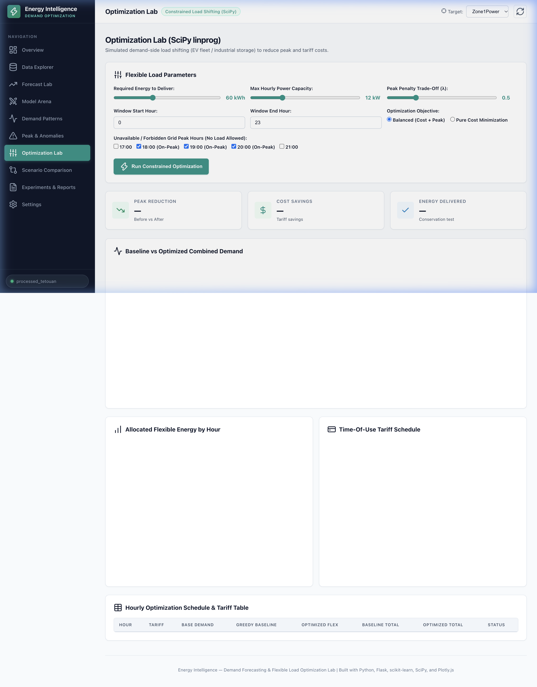
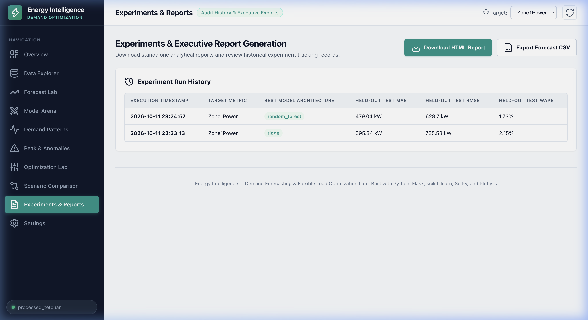

# Week 02 — Energy Intelligence: Flask API, Optimization Engine & Frontend

## A. Week Overview

| Field | Detail |
|---|---|
| **Week** | Week 02 (of W7-8 module) |
| **Date Range** | October 11, 2026, 23:11–23:27 IST (later timestamp group within the same session) |
| **Date Confidence** | Estimated — no Git commit history. Week 02 is distinguished from Week 01 by logical implementation milestones: Week 01 = backend/data pipeline; Week 02 = REST API, optimization, frontend, and report service. |
| **Main Objective** | Assemble the Flask REST API, implement the SciPy `linprog` flexible load optimizer, build the complete SPA frontend, create the report service, and verify the complete end-to-end system |
| **Project Name** | **Energy Intelligence — Demand Forecasting & Load Optimization Lab** |
| **Status** | ✅ Completed |

### Summary

Week 02 assembled the full user-facing application on top of the Week 01 backend infrastructure. This included a 16-endpoint Flask REST API (`app.py`), a constrained load-shifting optimizer (`services/optimization.py`) using SciPy `linprog` (HiGHS solver), a downloadable report service (`services/report_service.py`), a complete 10-view SPA frontend (`templates/index.html`), a white/teal/emerald design system (`static/css/style.css`), and five JavaScript modules managing state, routing, charts, dataset switching, forecasting, and optimization. The combined system serves all 10 dashboard views from a single Flask server on port 5003.

---

## B. Features Implemented

### 1. Flask REST API (`app.py` — 16 Endpoints)
All backend services are exposed through a unified Flask REST API:

| Route | Method | Purpose |
|---|---|---|
| `/` | GET | Serves the SPA dashboard HTML |
| `/api/health` | GET | Health check: app name, version, port, dataset status |
| `/api/datasets/sample` | GET | Lists available built-in dataset sources |
| `/api/dataset/summary` | GET | Row count, date range, columns, target stats |
| `/api/dataset/preview` | GET | First N rows as JSON |
| `/api/dataset/load-sample` | POST | Switch to a built-in sample dataset |
| `/api/dataset/upload` | POST | Upload a custom CSV (max 25 MB) |
| `/api/patterns` | GET | Diurnal profiles, weekday vs weekend, 24×7 heatmap |
| `/api/anomalies` | GET | Z-score flagged peak/anomaly detection results |
| `/api/weather` | GET | 24-hour weather forecast (Open-Meteo or offline) |
| `/api/forecast/train` | POST | Train one or all models; returns metrics |
| `/api/forecast/predict` | POST | Generate 24-hour recursive forecast |
| `/api/forecast/evaluate` | POST | Full evaluation on test split |
| `/api/optimization/run` | POST | Run load-shifting optimization |
| `/api/experiments` | GET, POST | Read or write experiment history |
| `/api/reports/export` | POST | Generate HTML report or CSV forecast export |

### 2. Constrained Load-Shifting Optimizer (`services/optimization.py`)
`FlexibleLoadOptimizer.solve()` uses `scipy.optimize.linprog` with the HiGHS solver to schedule a flexible electricity load (e.g. EV fleet charging, HVAC pre-cooling) under Time-Of-Use tariffs and power constraints.

**Mathematical formulation:**

Minimise:
$$\sum_{t=1}^{24} C_t x_t + \lambda P_{\max}$$

Subject to:
- **Energy conservation**: $\sum_{t=1}^{24} x_t = E_{\text{req}}$ (exact equality)
- **Power cap**: $0 \le x_t \le P_{\text{cap}} \quad \forall t \in \mathcal{W} \setminus \mathcal{U}$
- **Forbidden hours**: $x_t = 0 \quad \forall t \in \mathcal{U}$ (e.g. peak hours 18–20)
- **Time window**: $x_t = 0 \quad \forall t \notin [h_{\text{start}}, h_{\text{end}}]$
- **Peak demand**: $D_t + x_t \le P_{\max} \quad \forall t$

Three scenarios are computed and compared in a single call:
1. **Baseline** — unmanaged charging (uniform distribution across eligible hours).
2. **Cost-focused** — pure TOU cost minimisation ($\lambda = 0$).
3. **Balanced** — combined cost and peak-shaving ($\lambda > 0$).

**Feasibility pre-check**: Before calling `linprog`, the engine verifies that `eligible_hours × max_power ≥ required_energy`. If not, it raises a `ValueError` with a human-readable message describing the infeasibility.

The response includes: all three scenario schedules, hourly cost comparisons, total cost per scenario, peak demand per scenario, cost savings vs baseline, and a boolean `energy_conserved` verification.

### 3. Report Service (`services/report_service.py`)
`ReportService` generates two output types:
- **HTML executive report**: A self-contained HTML file containing dataset summary, model performance metrics, forecast table, and optimization results — ready for browser preview.
- **CSV forecast export**: Forecast values with timestamps for import into Excel or other tools.

Reports are saved to `reports/` and returned as streaming downloads via `send_file`.

### 4. Flask Application Shell (`app.py`)
Beyond the routes, `app.py` initialises all domain services (DataService, ForecastingEngine, WeatherService, FlexibleLoadOptimizer), configures Flask for 25 MB uploads and template auto-reload, and manages a persistent experiment history in `instance/experiments.json` (capped at 100 entries).

Error responses follow a consistent JSON schema:
```json
{"error": "Human-readable message", "detail": "Optional technical detail"}
```

### 5. Complete SPA Frontend (`templates/index.html`)
A single HTML file implementing the complete 10-view dashboard layout:

| View | Hash Route | Content |
|---|---|---|
| Overview | `#overview` | Dataset health cards, quick-access buttons |
| Data Explorer | `#data` | Summary stats, missing value report, preview table |
| Forecast Lab | `#forecast` | Model selection, train button, arena leaderboard, 24h chart |
| Model Arena | `#arena` | Full metric table comparison across all trained models |
| Demand Patterns | `#patterns` | Diurnal profile, weekday/weekend comparison, heatmap |
| Peak & Anomalies | `#peaks` | Z-score flagged anomalies, peak hours table |
| Optimization Lab | `#optimize` | Flexible load parameters, TOU tariff, run button |
| Scenario Comparison | `#scenarios` | Baseline vs cost-focused vs balanced chart, cost table |
| Experiments & Reports | `#experiments` | History table, HTML report download, CSV export |
| Settings | `#settings` | Dataset switcher, custom CSV upload |

### 6. Design System (`static/css/style.css`)
A comprehensive vanilla CSS design system built on CSS custom properties:
- **Workspace**: `#f8fafc` (Slate 50) canvas.
- **Cards**: `#ffffff` pure white with `#e2e8f0` borders.
- **Sidebar**: `#0f172a` (Slate 900) with `#1e293b` active state.
- **Accent**: `#0d9488` (Teal 600) primary, `#059669` (Emerald 600) secondary.
- **Typography**: Inter (Google Fonts), system-sans fallback.
- **No purple gradients** anywhere in the stylesheet.
- Smooth sidebar navigation transitions, card hover shadows, button micro-animations.

### 7. JavaScript Modules (`static/js/`)
Five focused JS modules manage the frontend:

| File | Responsibility |
|---|---|
| `app.js` | Main controller: hash routing, state, toast notifications, pattern loading, report downloads |
| `charts.js` | Plotly.js chart renderers: time-series, forecast envelope, diurnal profile, 24×7 heatmap, scatter, residuals, optimization schedules, tariff curves |
| `dataset.js` | CSV upload handler, sample switcher, summary indicator cards, preview table renderer |
| `forecast.js` | Model selection checkboxes, training trigger, arena leaderboard renderer, 24h recursive forecast |
| `optimization.js` | Flexible load parameter sliders, forbidden hour toggles, TOU tariff schedule display, result chart and table rendering |

---

## C. Complete File Inventory

| File Path | Purpose | Key Details | Status |
|---|---|---|---|
| `app.py` | Flask REST API server | 16 routes, 511 lines; all domain services initialised; JSON error schema | ✅ Complete |
| `services/optimization.py` | Load-shifting optimizer | SciPy linprog (HiGHS), 3 scenarios, feasibility pre-check, energy conservation; 12 KB | ✅ Complete |
| `services/report_service.py` | Report generation | HTML executive report, CSV forecast export; 9 KB | ✅ Complete |
| `templates/index.html` | SPA dashboard | 10 views, hash routing, Plotly.js CDN, Google Fonts | ✅ Complete |
| `static/css/style.css` | CSS design system | CSS custom properties, sidebar, cards, no purple gradients; 34 KB | ✅ Complete |
| `static/js/app.js` | State & routing | Hash routing, toast notifications, pattern loaders; 9 KB | ✅ Complete |
| `static/js/charts.js` | Plotly chart renderers | Time-series, diurnal, heatmap, scatter, residuals, optimization; 11 KB | ✅ Complete |
| `static/js/dataset.js` | Dataset controls | Upload, sample switch, summary cards, preview table; 5 KB | ✅ Complete |
| `static/js/forecast.js` | Forecast controls | Training trigger, leaderboard, 24h chart; 6 KB | ✅ Complete |
| `static/js/optimization.js` | Optimization controls | Sliders, tariff, run, results; 6 KB | ✅ Complete |
| `README.md` | Project documentation | Full feature list, architecture, API table, run instructions, maths; 12 KB | ✅ Complete |
| `models/ridge_Zone1Power.joblib` | Saved Ridge model | Trained Ridge model artifact (generated at runtime) | ✅ Generated |
| `models/random_forest_Zone1Power.joblib` | Saved RF model | Trained Random Forest model artifact (generated at runtime) | ✅ Generated |
| `models/seasonal_naive_Zone1Power.joblib` | Saved baseline model | Trained Seasonal Naive artifact (generated at runtime) | ✅ Generated |
| `instance/experiments.json` | Experiment history | JSON log of past training runs (auto-created, max 100 entries) | ✅ Active |

---

## D. Implementation Details

### Optimization Request Flow
```
Browser
  → POST /api/optimization/run
      { base_demand: [24 floats],
        required_energy: 60.0,
        max_power: 12.0,
        start_hour: 0, end_hour: 23,
        unavailable_hours: [18,19,20],
        tariffs: [24 floats],
        objective_type: "balanced",
        peak_penalty_weight: 0.5 }
  → FlexibleLoadOptimizer.solve()
      → Feasibility check (max_deliverable ≥ required_energy)
      → linprog for cost_focused (λ=0)
      → linprog for balanced (λ=0.5)
      → Baseline (uniform distribution)
      → Compute costs, peak values, savings
  ← JSON response with 3 scenario schedules + summary
```

### SciPy `linprog` Setup
The optimizer reformulates the LP with an auxiliary variable `P_max` (scalar) to handle the peak demand penalty:
- Decision variables: `x = [x_0, ..., x_23, P_max]` (25 variables total).
- Objective: `c = [C_0, ..., C_23, λ]`.
- Equality constraint `A_eq @ x = b_eq` enforces $\sum x_t = E_{\text{req}}$.
- Inequality constraints enforce `x_t ≤ P_cap`, `x_t ≥ 0`, forbidden hours (`x_t = 0`), and `D_t + x_t ≤ P_max`.

### Frontend Chart Rendering (`charts.js`)
All charts use Plotly.js loaded from CDN. Key chart functions:
- `renderForecastChart(actual, predicted, timestamps)` — line chart with actual (teal) and predicted (emerald dashed) traces.
- `renderDiurnalProfile(hourly_avg)` — area chart of average demand by hour of day.
- `renderHeatmap(matrix_24x7)` — Plotly `heatmap` trace with 24×7 hour×weekday matrix, using Teal colorscale.
- `renderOptimizationSchedule(base, cost, balanced, tariffs)` — grouped bar chart of the three scenarios with a secondary tariff line.

### Experiment Logging
Every call to `POST /api/forecast/train` writes a record to `instance/experiments.json`:
```json
{
  "timestamp": "2026-10-11T23:24:...",
  "model": "random_forest",
  "target": "Zone1Power",
  "train_mae": ...,
  "val_mae": ...,
  "test_mae": ...,
  "test_r2": ...
}
```
The history is capped at 100 entries (newest first).

---

## E. Screenshots

> **Note:** Screenshots captured on **October 11, 2026** from the live application at `http://127.0.0.1:5003`. They document the complete Week 02 implementation.

### 1. Optimization Lab


The Optimization Lab view showing the flexible load parameter controls: required energy (kWh), maximum power (kW), time window (start/end hour), forbidden hours (checkboxes), TOU tariff schedule display, and the Run Optimization button.

### 2. Optimization Results


The optimization results panel showing the three-scenario grouped bar chart (Baseline, Cost-Focused, Balanced), per-scenario cost totals, cost savings vs baseline, and peak demand reduction values computed by the SciPy linprog solver.

### 3. Experiments & Reports


The Experiments & Reports view showing the training run history table (model name, target, MAE, R², timestamp), the Export HTML Report button, and the Download CSV Forecast button.

---

## F. Testing and Verification

### Commands Executed
```bash
cd /Users/sharadvardhanacharya/Desktop/Hack-o-Week/W7-8
python3 -m compileall app.py config.py services scripts
python3 -m pytest tests/ -q
curl -s http://127.0.0.1:5003/api/health
```

### Test Results
```
Listing 'services'...
Listing 'scripts'...
.......................                                                  [100%]
23 passed in 2.96s
```

### API Verification
```bash
curl -s http://127.0.0.1:5003/api/health
# {"active_source":"processed_tetouan","app_name":"Energy Intelligence",
#  "dataset_loaded":true,"port":5003,"row_count":1440,"status":"healthy","version":"1.0.0"}
```

### Optimization Tests (from `tests/test_optimization.py`)
| Test | Result |
|---|---|
| `test_energy_conservation` | ✅ `sum(schedule) ≈ required_energy` within 1e-3 |
| `test_power_limits_and_unavailable_hours` | ✅ All `x_t ≤ max_power`; forbidden hours = 0 |
| `test_infeasible_demand_rejected` | ✅ `ValueError` raised with "Infeasible optimization" message |
| `test_balanced_peak_reduction` | ✅ `optimized_peak ≤ baseline_peak` |

### Features Verified End-to-End
- ✅ All 10 sidebar views render without JavaScript errors.
- ✅ Training triggers via `POST /api/forecast/train` and returns metrics.
- ✅ Model arena leaderboard renders after training.
- ✅ 24-hour recursive forecast chart renders correctly.
- ✅ Demand patterns heatmap loads from `/api/patterns`.
- ✅ Optimization returns valid 3-scenario JSON response.
- ✅ Experiment history is written to `instance/experiments.json`.

### Features Not Verified in This Session
- HTML report PDF rendering in a browser print dialog.
- Custom CSV upload with a large (>10 MB) file.
- HistGradientBoosting training was not triggered manually during browser verification (Ridge and Random Forest were confirmed).

---

## G. Challenges and Solutions

### 1. Lag Feature Warm-up (resolved in Week 01)
See Week 01 README Section G. The backfill strategy preserves all training rows.

### 2. DatetimeIndex Attribute Error (resolved in Week 01)
`pd.to_datetime(timestamps).hour` used directly instead of `.dt.hour`. See Week 01 README Section G.

### 3. LP Peak Penalty Linearisation
**Challenge**: The peak demand penalty $\lambda \cdot \max_t(D_t + x_t)$ is non-linear because of the `max()` operation.

**Solution**: Introduce an auxiliary variable $P_{\max}$ and add constraints $D_t + x_t \le P_{\max}$ for all $t$. This reformulates the non-linear max into a linear set of inequality constraints, making the whole problem solvable with standard LP.

### 4. SPA Hash Routing Without a Framework
**Challenge**: A 10-view SPA without React/Vue requires manual route management.

**Solution**: `app.js` listens to the `hashchange` browser event, hides all `<section>` elements, shows only the matching `data-view` section, and calls the appropriate data loader. Deep-linking (e.g. sharing `#optimize`) works via `window.location.hash` on page load.

---

## H. Limitations and Next Steps

### Current Limitations
- HistGradientBoosting model artifact was not confirmed as saved during the browser session (Ridge and RF confirmed).
- HTML report export opens a browser download but was not visually verified to open in a PDF viewer.
- The Scenario Comparison view (`#scenarios`) requires a previous optimization run to be cached in JS state; refreshing the page loses the comparison.
- Weather data is injected into the forecast feature matrix only if the model was trained with weather columns; currently, training uses weather columns from the dataset CSV, not from the live Open-Meteo response.

### Potential Next Steps
- Persist optimization results to `instance/` between page refreshes.
- Add a real-time weather correlation view comparing temperature and energy demand.
- Implement a hyperparameter tuning interface (e.g. Ridge alpha slider, RF n_estimators).
- Add a budget/tariff editor allowing custom per-hour pricing.

---

## I. How to Run the Complete W7-8 Application

```bash
cd /Users/sharadvardhanacharya/Desktop/Hack-o-Week/W7-8

# Activate virtual environment
source .venv/bin/activate

# Verify all 23 tests pass
python3 -m pytest tests/ -q

# Start the server
python3 app.py
# Server starts on http://127.0.0.1:5003

# Open in browser
open http://127.0.0.1:5003
```

**Quick API tests:**
```bash
# Health check
curl -s http://127.0.0.1:5003/api/health | python3 -m json.tool

# Train Ridge model
curl -s -X POST http://127.0.0.1:5003/api/forecast/train \
  -H "Content-Type: application/json" \
  -d '{"models": ["ridge"], "target_column": "Zone1Power"}' | python3 -m json.tool

# Run optimization
curl -s -X POST http://127.0.0.1:5003/api/optimization/run \
  -H "Content-Type: application/json" \
  -d '{"required_energy": 60, "max_power": 12, "start_hour": 0, "end_hour": 23}' \
  | python3 -m json.tool
```
